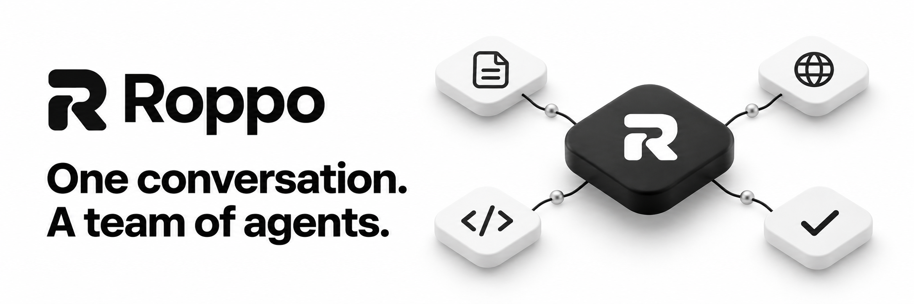
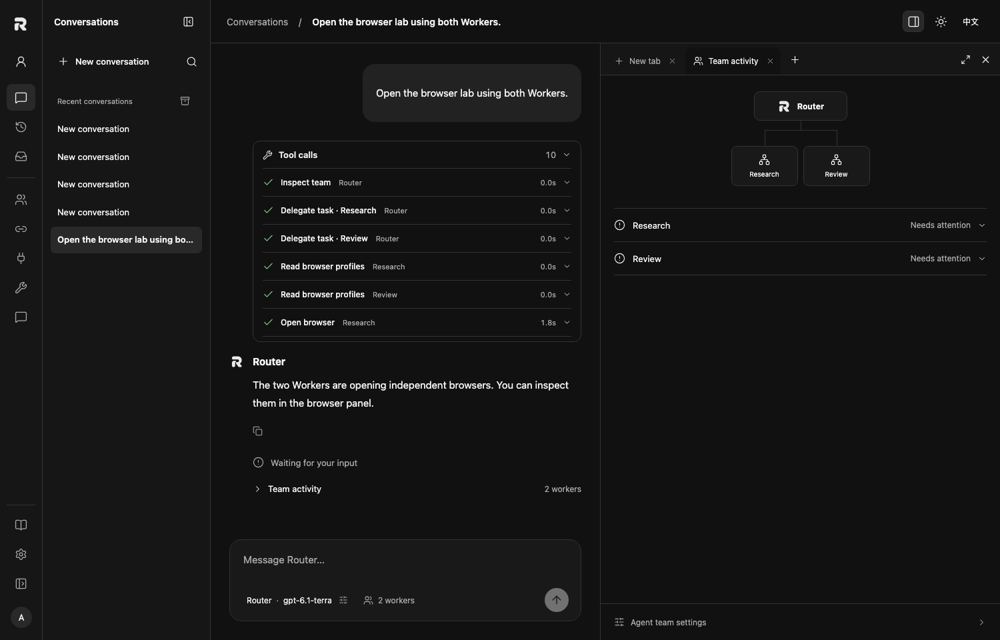
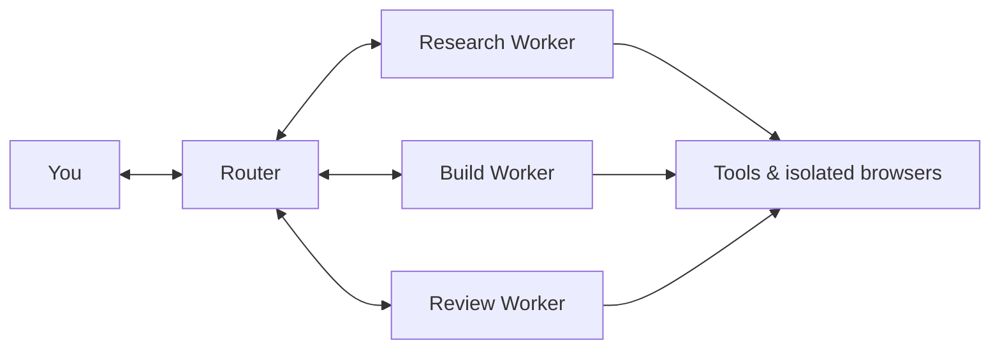

<p align="center">
  
</p>

<p align="center">
  <a href="README.md">English</a> · <a href="README.zh-CN.md">简体中文</a>
  <br>
  <a href="#quick-start">Quick start</a> · <a href="#your-workspace">Workspace</a> · <a href="#documentation">Docs</a> · <a href="https://github.com/pythc/agent-hub/discussions">Community</a>
</p>

<p align="center">
  <a href="https://github.com/pythc/agent-hub/actions/workflows/ci.yml"></a>
  <a href="LICENSE"></a>
  <a href="https://github.com/pythc/agent-hub/discussions"></a>
</p>

**Roppo is a local-first workspace for your AI team.** Give a task to the Router. It coordinates Workers, follows their progress, and brings the results back to your conversation. Files, browsers, tool calls, and team activity stay beside the work.

Built on the domain core of [DeepSeek Super Agent](https://github.com/deepseek-ai/dsh-superagent-prototype). Bring your own model access, configure each agent, and keep your workspace on your own machine.

## Quick start

You need **Node.js 22.19+**, Git, and a supported model connection.

```sh
git clone https://github.com/pythc/agent-hub.git
cd agent-hub
npm ci
./start.sh
```

1. **Create your local account.** The browser opens automatically. Keep your recovery code.
2. **Connect a model.** Add your connection in **Model connections**.
3. **Set up your team.** In **Agent team**, select a hosted Router and configure your Workers.
4. **Start a conversation.** Give the Router a task and watch the team work.

No Roppo cloud account is required. The launcher creates or reopens your installation in `~/.agent-hub`. Returning to an existing deployment? [Start it with its original configuration](docs/OPERATIONS.md#start-the-right-instance).

## Your workspace

<picture>
  <source media="(prefers-color-scheme: dark)" srcset="docs/images/workspace-dark.png">
  <source media="(prefers-color-scheme: light)" srcset="docs/images/workspace-light.png">
  
</picture>

The running interface with isolated demo data; model names and results shown are fixtures.

### One conversation, a coordinated team

Talk to the **Router** while **Workers** carry out delegated tasks. Configure the Router and 1–10 Workers independently: model, instructions, reasoning, provider parameters, and tools. Follow up or interrupt from the same conversation.

### See the work as it happens

Stream replies, expand tool calls, and follow real Worker activity. Tasks and execution history persist across host restarts. Failed calls remain visible, and uncertain external actions need reconciliation before retrying.

### A browser beside your task

Open files, browsers, and team activity in closable tabs. Browser profiles retain login state; passwords can be saved in Roppo's local encrypted vault. Grant Workers access to selected login state, with a separate writable browser session for each assignment. **Take over** whenever a task needs you.

### Make it your workspace

Switch between light and dark themes, use English or Chinese, and collapse the sidebar to focus. Connect the same host to MCP clients, Feishu, WeCom, GitHub, or your own source adapters.

Try a task such as:

- “Compare these options, check their official sources, and prepare a recommendation.”
- “Implement this change, ask another Worker to review it, and show me the test results.”
- “Inspect this website with the browser. Pause when you need me to sign in.”

## Bring your own models

| Access | Supported adapters | Setup |
| --- | --- | --- |
| **Model API** | OpenAI Responses, OpenAI Chat Completions, Anthropic Messages | Compatible endpoint, model, and credentials |
| **CLI** | Native Codex app-server | Codex installed and authenticated on the host |
| **Subscription** · experimental | Direct ChatGPT sign-in | Eligible provider account; subject to provider availability and usage rules |

API-only setups do not require Codex. Each role can use its own connection. Reasoning options depend on the selected model; unsupported options produce an error.

Direct ChatGPT sign-in has protocol regression coverage but still needs live-account acceptance. It is separate from the native Codex path. Additional subscription providers and CLIs need adapters. [Model setup →](docs/MODELS.md)

<details>
<summary><strong>Set up the embedded browser</strong></summary>

On macOS, Roppo can use installed Google Chrome. Otherwise, install the browser runtime or set `browser.executablePath`:

```sh
npx agent-browser install
```

Create a profile from the conversation's browser tab, sign in, and choose which Workers may reuse that login state. Taking over pauses Worker control until you hand it back.

The password vault is separate from your everyday Chrome password manager. Isolated sessions using the same website account still share that account's server-side data. See the [browser guide](docs/BROWSER.md) (中文).

</details>

## Built on Super Agent



The Router owns the conversation; Workers report back to it. The host tracks admission, assignments, follow-ups, reports, and delivery explicitly: accepted work is not yet completed work.

Roppo preserves 15 domain-core files from DeepSeek's prototype at `8c32a9d`. The workspace, persistent Router, model adapters, and browser are Roppo extensions. This does not imply identical model behavior or complete upstream integration parity. See [parity](docs/PARITY.md) and [third-party notices](THIRD_PARTY.md). Roppo is an independent project.

## Current scope

Roppo is **personal-first and under active development**: one local account per deployment. Organization identity, tenant isolation, and enterprise permissions are future work.

Local-first means local workspace storage; model requests still go to your provider. The host binds to loopback, and remote access needs a separately configured secure connection. Embedded-browser acceptance has been completed on macOS with Chrome; Linux and Windows browser acceptance remains pending. Before upgrading, read the [backup and operations guide](docs/OPERATIONS.md).

## Documentation

| Use Roppo | Extend Roppo |
| --- | --- |
| [Models and connections](docs/MODELS.md) | [Backend protocols](docs/BACKENDS.md) · 中文 |
| [Operations and backups](docs/OPERATIONS.md) | [Sources and tools](docs/INTEGRATIONS.md) · 中文 |
| [Local accounts](docs/PERSONAL_ACCOUNT.md) · 中文 | [MCP clients](docs/clients/README.md) · 中文 |
| [Conversations](docs/CHAT.md) · 中文 | [Core semantics and parity](docs/PARITY.md) · 中文 |
| [Agent board](plugins/agent-board/README.md) | [Workspace view plugins](docs/WORKSPACE_VIEWS.md) |
| [Plugin marketplace](docs/PLUGIN-MARKETPLACE.md) | [Marketplace design](docs/PLUGIN-MARKETPLACE-DESIGN.md) |
| [Browser and handoff](docs/BROWSER.md) · 中文 | [Office integrations](docs/OFFICE.md) · 中文 |
| [Proactive Router and token costs](docs/PROACTIVE_ROUTER.md) | Admission, follow-ups, context and compatibility |
| [Long-running goals and acceptance](docs/GOAL_ACCEPTANCE_2026-11-07.md) · 中文 | [Failure-driven replanning](docs/GOAL_REPLANNING_2026-11-07.md) · 中文 |
| [Scoped memory and continuity](docs/EMBEDDED_KNOWLEDGE_AND_CONTINUITY_2026-11-07.md) · 中文 | Embedded document library and sourced context |
| [Webhooks and acceptance callbacks](docs/WEBHOOKS.md) · 中文 | Signed events, approved automation, durable delivery and recovery |

## Build with us

Questions, workflows, bug reports, and contributions are welcome in English or Chinese.

[Introduce yourself](https://github.com/pythc/agent-hub/discussions/4) · [Start a discussion](https://github.com/pythc/agent-hub/discussions) · [Report a bug](https://github.com/pythc/agent-hub/issues/new/choose) · [Find a first issue](https://github.com/pythc/agent-hub/issues?q=is%3Aissue%20is%3Aopen%20label%3A%22good%20first%20issue%22)

```sh
npm ci
npm run check
```

Read [CONTRIBUTING.md](CONTRIBUTING.md) for development and isolated testing. Follow the [roadmap](ROADMAP.md), [community guide](docs/COMMUNITY.md), and [code of conduct](CODE_OF_CONDUCT.md). Report sensitive issues through the [security policy](SECURITY.md).

## License & acknowledgements

Roppo is licensed under [Apache-2.0](LICENSE). Third-party components retain their licenses, including the DeepSeek domain core under MIT. See [NOTICE](NOTICE) and [THIRD_PARTY.md](THIRD_PARTY.md).

Built with [DeepSeek Super Agent](https://github.com/deepseek-ai/dsh-superagent-prototype), [assistant-ui](https://github.com/assistant-ui/assistant-ui), [agent-browser](https://github.com/vercel-labs/agent-browser), React, Vite, and the MCP SDK.

The repository and CLI retain the name `agent-hub`.

Developer source packages: see [Plugins](docs/PLUGINS.md) for Feishu, Slack and Linear adapters and controlled upgrade/rollback.
Optional [decision layer](docs/DECISION-LAYER.md): connect Jev, model APIs or a local model for intent classification, with record-only and advisory modes.
