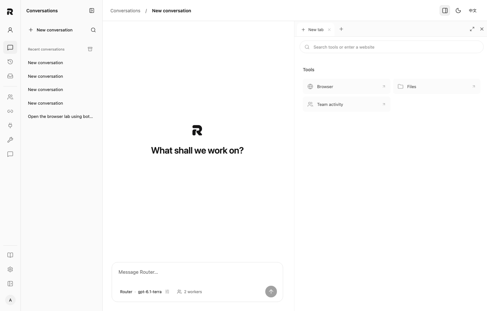
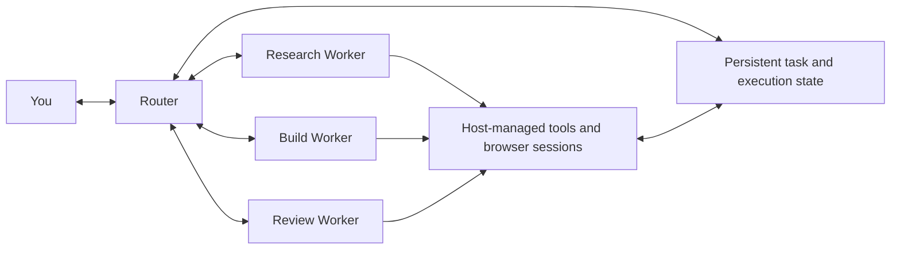

# Roppo

**One conversation. A team of agents. Your workspace.**

[English](README.md) · [简体中文](README.zh-CN.md)

[](https://github.com/pythc/agent-hub/actions/workflows/ci.yml)
[](LICENSE)
[](package.json)
[](https://github.com/pythc/agent-hub/discussions)

Roppo is a local-first workspace for working with a team of AI agents. Talk to a **Router** that coordinates the work, delegates to **Workers**, and brings their results back to your conversation. Keep files, browser sessions, tool calls, and team activity alongside the task.

Built on the domain core of [DeepSeek's Super Agent prototype](https://github.com/deepseek-ai/dsh-superagent-prototype), Roppo adds a personal workspace, configurable model connections, and persistent execution. The repository and CLI still use the name `agent-hub`.

[Get started](#get-started) · [How it works](#how-it-works) · [Documentation](#documentation) · [Join the community](#join-the-community)


*The running interface with isolated demo data. Model names and results in this screenshot are fixtures.*

## A workspace for the whole task

- **Talk to one coordinator.** The Router handles the conversation; Workers execute delegated work and report back to it. Follow up, stop a run, or take over when needed.
- **Choose a model for each role.** Configure the Router and 1–10 Workers independently: connection, model, instructions, reasoning options, provider parameters, and tools.
- **See what is happening.** Stream replies, inspect tool calls, and follow real team activity. Failed calls and interrupted runs remain visible.
- **Work with the web.** Open a browser inside the conversation. Keep personal login state, save credentials in a local encrypted vault, and explicitly share allowed login state with isolated Worker browsers.
- **Keep work across sessions.** Conversations, tasks, execution history, and recovery state are persisted on your host. Uncertain external actions require reconciliation before retrying.
- **Use your existing entry points.** Connect MCP clients, Feishu, WeCom, GitHub, or custom source adapters to the same host.

The interface supports English and Simplified Chinese, light and dark themes, a collapsible conversation list, and closable tabs for files, browsers, and team activity.

<details>
<summary>See the light theme and tool launcher</summary>



</details>

## Get started

You need **Node.js 22.19 or newer**, Git, and access to a supported model backend. Roppo itself does not require a hosted account.

```sh
git clone https://github.com/pythc/agent-hub.git
cd agent-hub
npm ci
./start.sh
```

1. Create your local account in the browser and keep the recovery code.
2. Add a connection in **Model connections**.
3. In **Agent team**, choose a hosted Router and configure your Workers.
4. Open **New conversation** and give the Router a task.

The launcher builds the web interface and opens your local workspace. It uses `~/.agent-hub` by default and reuses an existing instance. Remembered browser sessions survive host restarts until they expire. To use a private installation directory without opening a browser:

```sh
./start.sh setup /path/to/private-directory --no-open
```

For an existing deployment, keep its configuration and state directory:

```sh
./start.sh serve /path/to/config.json
```

### Bring your own model access

| Connection | Implemented adapters | What you need |
| --- | --- | --- |
| Model API | OpenAI Responses, OpenAI Chat Completions, Anthropic Messages | A compatible endpoint, supported model, and credentials |
| Subscription | ChatGPT sign-in adapter | An eligible provider account; availability and usage rules are controlled by the provider |
| CLI | Native Codex app-server | Codex installed and authenticated on the host |

API-only setups do not require Codex. A CLI connection uses that CLI's configured authentication and billing. Direct ChatGPT sign-in has protocol regression coverage but has **not yet completed live-account acceptance**; it is separate from the tested native Codex path. Other subscription providers and CLIs require additional adapters.

Reasoning controls depend on the selected model. Unsupported options are reported as errors; Roppo does not silently reinterpret them. See [model configuration](docs/MODELS.md) for the supported scope.

### Enable the embedded browser

On macOS, Roppo can use an installed Google Chrome. Otherwise, install the browser runtime or configure `browser.executablePath`:

```sh
npx agent-browser install
```

Create a browser profile in the conversation, sign in to websites, then choose which Workers may reuse that login state. Each assignment gets a separate writable browser session. **Take over** pauses Worker control until you hand it back.

Saved passwords belong to Roppo's local encrypted vault; Roppo does not import your everyday Chrome password manager. Sessions using the same website account can still affect the same server-side data. See [browser behavior and limits](docs/BROWSER.en.md).

## How it works



The host keeps task admission, assignments, follow-ups, reports, and delivery state explicit. A received request is not a completed task, and a queued tool call is not a successful result. The Router is the user's conversation partner; there is no separate user-to-Worker chat flow.

Roppo vendors 15 domain-core files from the DeepSeek prototype at commit `8c32a9dc5d72c033816c6a8110b37f40cf94fba4`. The workspace, persistent Router, backend adapters, and browser are Roppo extensions. Core equivalence does not imply identical model behavior or complete upstream integration parity. See the [parity record](docs/PARITY.md) and [third-party notices](THIRD_PARTY.md). Roppo is an independent project, not an official DeepSeek product.

## Status and boundaries

Roppo is under active development and is **personal-first** today: one local account per deployment. Organization identity, tenant isolation, and enterprise permissions are not implemented as a complete product.

- The host binds to loopback. Remote access needs a separately configured secure connection.
- Model requests go to your selected provider. Local-first refers to workspace ownership and persistence, not offline inference.
- The embedded browser has been exercised on macOS with Chrome. Linux sandbox support has separate validation; full browser acceptance on Linux and Windows is still pending.
- Database backups do not include every personal credential, browser profile, or working directory. Read [operations and backup](docs/OPERATIONS.md) before migrating or upgrading.

## Documentation

| Start here | Go deeper |
| --- | --- |
| [Model connections](docs/MODELS.md) | [Backend protocol reference](docs/BACKENDS.md) (中文) |
| [Operations and backup](docs/OPERATIONS.md) | [Task semantics and parity](docs/PARITY.md) (中文) |
| [Local accounts](docs/PERSONAL_ACCOUNT.md) (中文) | [Source and tool adapters](docs/INTEGRATIONS.md) (中文) |
| [Conversations](docs/CHAT.md) (中文) | [MCP clients](docs/clients/README.md) (中文) |
| [Embedded browser](docs/BROWSER.en.md) | [Office integrations](docs/OFFICE.md) (中文) |

## Build and contribute

```sh
npm ci
npm run check
```

`check` type-checks the host and chat UI, builds the frontend, and runs the regression suite. Browser acceptance and live-provider checks are separate; see [CONTRIBUTING.md](CONTRIBUTING.md) for isolated fixtures and safe test setup.

The host lives in `src/`, the React chat workspace in `web/chat/`, the shared management UI in `src/ui/`, and regression tests in `tests/`. Keep the vendored domain core unchanged unless an upstream update is deliberate and documented.

## Join the community

Help shape a workspace you would use every day. English and Chinese contributions are welcome.

- [Ask a question or share a workflow](https://github.com/pythc/agent-hub/discussions).
- [Report a reproducible bug or propose a feature](https://github.com/pythc/agent-hub/issues/new/choose).
- [Pick up a contribution](CONTRIBUTING.md), improve a guide, or test an adapter.
- Read the [roadmap](ROADMAP.md), [community guide](docs/COMMUNITY.md), and [code of conduct](CODE_OF_CONDUCT.md).
- Report sensitive issues through the [security policy](SECURITY.md).

## License and credits

Original Roppo code is licensed under [Apache-2.0](LICENSE). Third-party code retains its own license, including the DeepSeek domain core under MIT. See [NOTICE](NOTICE) and [THIRD_PARTY.md](THIRD_PARTY.md).

Built with [DeepSeek Super Agent](https://github.com/deepseek-ai/dsh-superagent-prototype), [assistant-ui](https://github.com/assistant-ui/assistant-ui), [agent-browser](https://github.com/vercel-labs/agent-browser), React, Vite, and the MCP SDK. Thank you to their maintainers and contributors.
