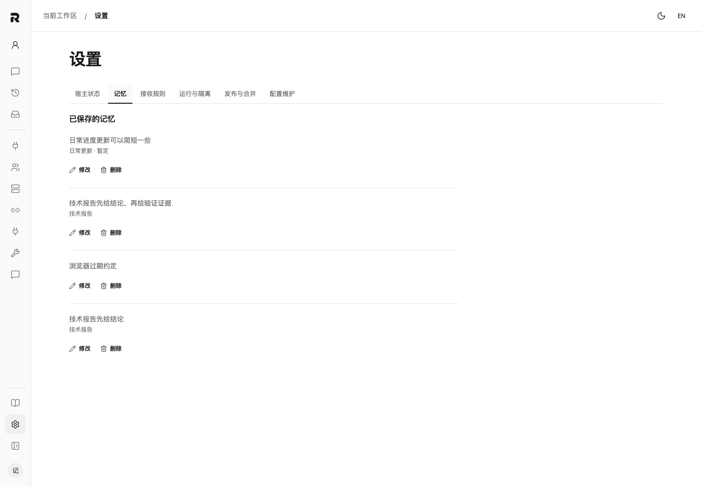

<p align="center">
  
</p>
<h1 align="center">Roppo</h1>

<p align="center"><strong>Your personal agent. A team when the work needs one.</strong></p>
<p align="center">
  English · <a href="README.zh-CN.md">简体中文</a><br>
  <a href="#product-tour">Watch the video</a> · <a href="#your-workspace">Explore Roppo</a> · <a href="#quick-start">Get started</a> · <a href="https://github.com/pythc/agent-hub/discussions">Community</a>
</p>
<p align="center">
  <a href="https://github.com/pythc/agent-hub/actions/workflows/ci.yml"></a>
  <a href="LICENSE"></a>
</p>

**Tell Roppo what you want done, then review the result.** Roppo is an open-source, local-first workspace for coding, research, documents and recurring work. Your Router keeps the conversation and coordinates execution; a Worker normally owns the whole task, with additional help when it is useful.

## Product tour

[](https://github.com/pythc/agent-hub/raw/refs/heads/main/docs/media/roppo-product-en.mp4)

**[Watch the English video · 2:57 · 1080p](https://github.com/pythc/agent-hub/raw/refs/heads/main/docs/media/roppo-product-en.mp4)** — English UI and captions, no voiceover. This concept film includes the broader product vision. The screenshots and interaction GIFs below show the running interface with isolated demo data. [Media notes](docs/images/README.md#product-tour-media).

## Your workspace


### Start with the outcome

> “Review this launch brief, check the numbers, and give me a concise plan for Monday.”

Attach the material and send one message. Follow the task, tool calls and replies in the same conversation. Add a correction or stop a run whenever you need to.


Other places to start:

| Work | Try asking |
| --- | --- |
| Code | “The summary cuts emoji in half. Fix it, add a regression check, and show me the result.” |
| Research | “Compare these three options using their official sources, then recommend one for this project.” |
| Documents | “Compare this brief with the spreadsheet and list the numbers that do not agree.” |
| Recurring work | “Every weekday at 9, summarize the open issues and tell me what needs attention.” |

### One conversation. Two views.

Use **Group chat** to see Router and Workers together. Switch to the **Agents** list to focus on a particular agent and its latest message. Worker conversations are read-only; keep talking to your Router.


<picture>
  <source media="(prefers-color-scheme: dark)" srcset="docs/images/product/agents-dark.jpg">
  
</picture>

### Bring your files. Keep the details readable.

Upload documents, spreadsheets, images, code or archives. Send multiple files together, drag them in, or paste an image. Replies render Markdown, tables, code and LaTeX; original attachments stay available to download.


Up to **32 files per message, 100 MiB each**. Understanding a particular format depends on the chosen model and task tools. [Files and formulas →](docs/CHAT_FILES_MATH_ACCEPTANCE.md)

### Let it learn how you work

Start with a task, then express preferences naturally as you go. Roppo can retain useful preferences and working context for later tasks. In **Settings**, you can edit or delete saved memories. For a temporary exception to a preference, set its expiry date and optionally enter the exact phrase that triggers it.



Give your Router and Workers their own names, models and tools. Use **Behavior rules** for shared preferences and role instructions, and preview the assembled instructions before saving. Chat display and clearing built-in Chat memory and context also live in Settings.

Use **Settings → Appearance** for light, dark or system mode, theme presets, custom colors and contrast, interface/content/code sizes, reduced motion, smart punctuation, full-width conversations and diff indicators. Copy or import a theme to share its colors. Preferences stay in this browser and apply across its Roppo pages; existing light/dark choices are retained when upgrading.

Save all appearance settings as a named **skin**, rename or delete saved skins, and share complete light/dark profiles and advanced options through `.roppo-skin.json` import/export. The reset icon beside **Visual style** restores the selected skin; temporary edits never overwrite it. New browsers follow the system color mode by default.

<picture>
  <source media="(prefers-color-scheme: dark)" srcset="docs/images/appearance-settings-dark.jpg">
  
</picture>

### Work where the task starts

Connect **Feishu, Slack, Linear and GitHub** through the available source adapters and plugins. Extend the toolset with **MCP** and app integrations. Keep each task connected to its source conversation or issue.

For repeatable workflows, use schedules or signed event automations. Inspect incoming events, task outcomes and delivery receipts in the workspace. The host must stay running for scheduled work. [Integrations](docs/PLUGINS.md) · [Schedules](docs/PROACTIVE_ROUTER.md) · [Event automations](docs/WEBHOOKS.md)

In Chat, open **Session panel → Schedules** to pause a reminder, change its timing or jump to its last delivery. A lightweight reminder posts its text directly into the original conversation. In Settings, **Reminders and methods** shows schedules, goals and saved methods for the selected workspace.


### Keep the browser beside the work

Workers can use isolated browser sessions with selected saved login state. Open the browser beside the conversation, inspect the page, and **take over** when a site needs your input. Files and team activity are available in the same side panel. [Browser guide →](docs/BROWSER.en.md)

## Quick start

You need **Node.js 22.19+**, Git and a supported model connection.

```sh
git clone https://github.com/pythc/agent-hub.git
cd agent-hub
npm ci
./start.sh
```

Create your local account, connect a model, configure a hosted Router and add Workers as needed, then open **Conversations**. No Roppo cloud account is required. The launcher keeps your installation in `~/.agent-hub`.

Prefer Docker? With Docker and Compose running:

```sh
./deployment/compose.sh up
```

This builds the Linux runtime with Chromium and Bubblewrap, creates a persistent data volume, and prints a local setup link. [Docker setup and upgrades](docs/DOCKER.md) · [Reopen an existing installation](docs/OPERATIONS.md#start-the-right-instance)

From this checkout, run `npm link` to install the terminal command. Use `roppo login`, then run `roppo` to continue your personal conversation with the Router. `-c` and `-p` share that conversation; Worker collaboration stays in the background. [Roppo CLI guide](docs/TERMINAL.md). The terminal includes searchable `/config`, `/model`, `/effort`, `/permissions` and `/resume` menus, theme preferences, and `--output-format stream-json` for scripts.

## Bring your own models

| Connection | Options |
| --- | --- |
| Model API | OpenAI Responses, OpenAI Chat Completions and Anthropic Messages compatible endpoints |
| Local CLI | Native Codex app-server, using your installed and authenticated Codex |
| Experimental | Direct ChatGPT sign-in; protocol-tested, live-account acceptance still pending |

Choose connections per agent. API-only setups do not require Codex. [Model setup →](docs/MODELS.md)

## Current scope

Roppo is **personal-first and under active development**, with one local personal account per deployment. Organization identity, roles and multi-tenant access are future work. Data and runtime state are stored locally; requests to external models and connected services follow the connections you configure. Integration setup and available tools vary by adapter and provider.

## Documentation

| Start using Roppo | Go deeper |
| --- | --- |
| [Chat](docs/CHAT.md) · [Models](docs/MODELS.md) | [Configuration](docs/CONFIGURATION.md) · [Execution backends](docs/BACKENDS.md) |
| [Browser](docs/BROWSER.en.md) · [Plugins](docs/PLUGINS.md) | [Plugin development](docs/EXECUTION_PLUGINS.md) · [Webhooks](docs/WEBHOOKS.md) |
| [Docker](docs/DOCKER.md) · [Operations](docs/OPERATIONS.md) | [Architecture and core provenance](docs/PARITY.md) · [Roadmap](docs/ROADMAP.md) |

## Build with us

Bring a workflow, report a bug or contribute an improvement. English and Chinese are both welcome.

[Discussions](https://github.com/pythc/agent-hub/discussions) · [Report a bug](https://github.com/pythc/agent-hub/issues/new/choose) · [Contributing](CONTRIBUTING.md) · [Community guide](docs/COMMUNITY.md) · [Code of conduct](CODE_OF_CONDUCT.md) · [Security](SECURITY.md)

## License & acknowledgements

Roppo builds on the domain core of [DeepSeek Super Agent](https://github.com/deepseek-ai/dsh-superagent-prototype), with its own persistent Router, workspace, adapters and browser integration. It is an independent project; see [provenance and extension boundaries](docs/PARITY.md).

Licensed under [Apache-2.0](LICENSE). Third-party components retain their licenses, including the DeepSeek core under MIT. Thanks to [assistant-ui](https://github.com/assistant-ui/assistant-ui), [agent-browser](https://github.com/vercel-labs/agent-browser), React, Vite and the MCP SDK. [NOTICE](NOTICE) · [Third-party licenses](THIRD_PARTY.md)

The repository and CLI retain the name `agent-hub`.
