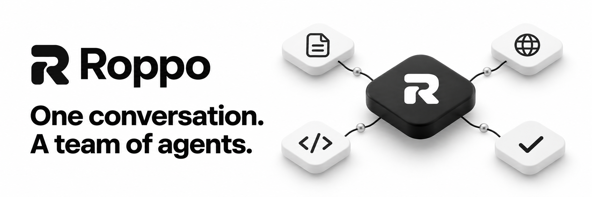
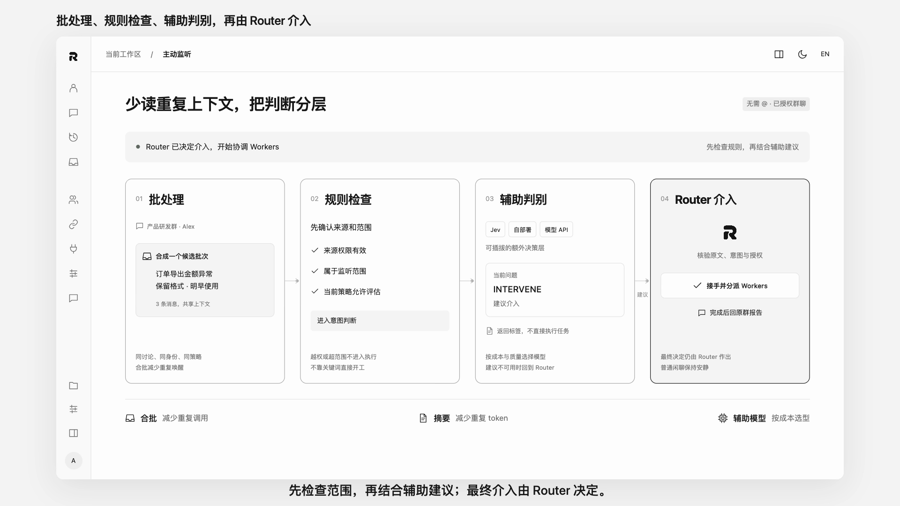
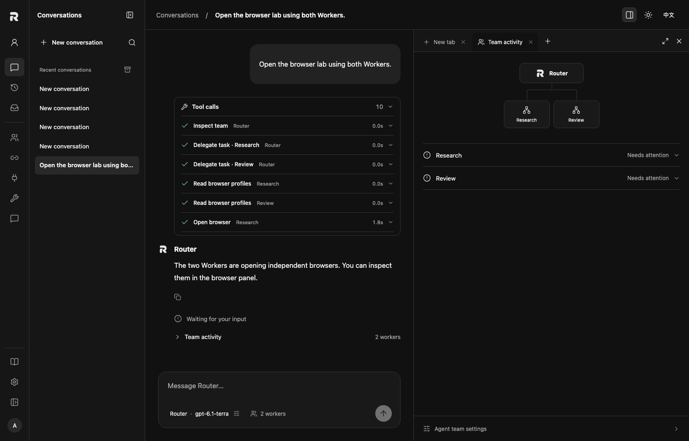
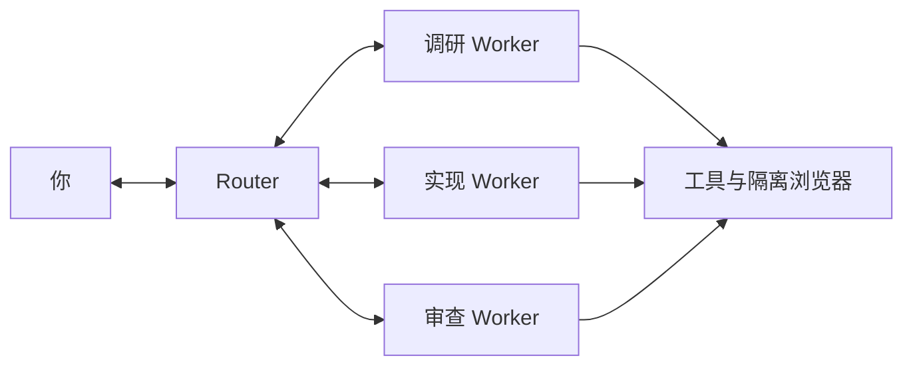

<p align="center">
  
</p>

<p align="center">
  <a href="README.md">English</a> · <a href="README.zh-CN.md">简体中文</a>
  <br>
  <a href="#快速开始">快速开始</a> · <a href="#你的工作空间">工作空间</a> · <a href="#文档">文档</a> · <a href="https://github.com/pythc/agent-hub/discussions">社区</a>
</p>

<p align="center">
  <a href="https://github.com/pythc/agent-hub/actions/workflows/ci.yml"></a>
  <a href="LICENSE"></a>
  <a href="https://github.com/pythc/agent-hub/discussions"></a>
</p>

**Roppo 是你的本地优先 AI 团队工作空间。** 把任务交给 Router，由它协调 Worker、跟进执行，并把结果带回对话。文件、浏览器、工具调用和团队动态，都在任务旁边。

基于 [DeepSeek Super Agent](https://github.com/deepseek-ai/dsh-superagent-prototype) 的领域核心构建。使用自己的模型接入方式，独立配置每个 Agent，把工作空间保留在自己的机器上。

## 产品演示

[](docs/media/roppo-concept-1080p.mp4)

2 分 39 秒，展示模型配置、群聊接入、额外决策层和可见的团队协作。界面与活动为编排演示，不代表真实生产执行。

[1080p MP4](docs/media/roppo-concept-1080p.mp4) · [可编辑源码](demos/roppo-concept-video/README.md)

## 快速开始

需要 **Node.js 22.19+**、Git，以及一种受支持的模型连接。

```sh
git clone https://github.com/pythc/agent-hub.git
cd agent-hub
npm ci
./start.sh
```

1. **创建本地账号。** 浏览器会自动打开，请保存恢复码。
2. **连接模型。** 在「模型连接」中添加接入方式。
3. **配置团队。** 在「Agent 团队」中选择托管 Router，并配置 Worker。
4. **开始对话。** 给 Router 一个任务，查看团队的执行过程。

无需注册 Roppo 云端账号。启动器会在 `~/.agent-hub` 创建或重新打开个人安装。已有部署请[沿用原配置启动](docs/OPERATIONS.md#start-the-right-instance)。

已安装并运行 Docker 和 Compose 时，也可在仓库根目录执行 `./deployment/compose.sh up`，构建含 Bubblewrap、Chromium 的 Linux 运行镜像，创建独立数据卷并打印配置链接。在网页中配置 API 模型即可开始使用。环境边界和备份升级操作见 [Docker 部署指南](docs/DOCKER.md)。

## 你的工作空间

<picture>
  <source media="(prefers-color-scheme: dark)" srcset="docs/images/workspace-dark.png">
  <source media="(prefers-color-scheme: light)" srcset="docs/images/workspace-light.png">
  
</picture>

截图来自实际运行的界面，使用隔离演示数据；图中的模型名称和结果均为测试样例。

### 一个对话，一支协作团队

你与 **Router** 对话，由 **Worker** 执行分配的任务。Router 和 1–10 个 Worker 可以分别配置模型、提示词、思考选项、服务商参数和工具。在同一个对话中继续补充要求或中断任务。

### 看见执行过程

流式查看回复、展开工具调用、跟踪真实的 Worker 动态。任务和执行历史会在主机重启后保留。失败调用保留记录；结果不确定的外部操作需要核实后再重试。

### 浏览器就在任务旁边

在可关闭的标签页中打开文件、浏览器和团队动态。浏览器配置保留登录状态，密码可保存到 Roppo 本地加密密码库。按需授权 Worker 复用登录状态，每项任务使用独立的可写浏览器会话。需要人工操作时，随时**接管**。

### 按你的习惯工作

支持黑白主题、中英文切换与可折叠侧栏。同一个主机还可以连接 MCP 客户端、飞书、企业微信、GitHub 或自定义来源适配器。

可以从这样的任务开始：

- “对比这几个方案，核对官方来源，整理一份建议。”
- “实现这个改动，让另一个 Worker 做 review，然后给我测试结果。”
- “用浏览器检查这个网站，需要我登录时暂停并交给我。”

## 使用自己的模型

| 接入方式 | 已支持的适配器 | 准备条件 |
| --- | --- | --- |
| **模型 API** | OpenAI Responses、OpenAI Chat Completions、Anthropic Messages | 兼容端点、模型和凭据 |
| **CLI** | 原生 Codex app-server | 主机已安装并登录 Codex |
| **订阅** · 实验性 | 直接登录 ChatGPT | 符合条件的服务商账号，受服务商可用性及使用规则约束 |

只使用 API 时不需要安装 Codex。每个角色可以选择自己的连接。思考选项取决于模型，无法支持的参数会明确报错。

直接登录 ChatGPT 已有协议回归测试，仍待真实账号验收；它与原生 Codex 接入是两条独立路径。其他订阅服务商及 CLI 需要新增适配器。[查看模型配置 →](docs/MODELS.md)

<details>
<summary><strong>启用内置浏览器</strong></summary>

macOS 上可以使用已安装的 Google Chrome。其他情况可安装浏览器运行时，或设置 `browser.executablePath`：

```sh
npx agent-browser install
```

从对话的浏览器标签页创建配置，登录网站，再选择哪些 Worker 可以复用登录状态。人工接管后，Worker 暂停操控，直到你交还控制权。

密码库独立于你日常使用的 Chrome 密码管理器。隔离会话如果使用同一个网站账号，仍会共享该账号的服务端数据。详见[浏览器指南](docs/BROWSER.md)。

</details>

## 基于 Super Agent



Router 负责与用户对话，Worker 向 Router 汇报。主机显式跟踪任务接入、分配、补充输入、报告与交付：接受任务不等于完成任务。

Roppo 保留了 DeepSeek 原型在 `8c32a9d` 的 15 个领域核心文件。工作空间、持久化 Router、模型适配器和浏览器属于 Roppo 扩展，不意味着模型行为完全一致或所有上游集成均已等价。详见[语义对齐记录](docs/PARITY.md)和[第三方声明](THIRD_PARTY.md)。Roppo 是独立项目。

## 当前范围

Roppo **优先服务个人，仍在持续开发**，每个部署对应一个本地账号。组织身份、多租户隔离和企业权限属于后续工作。

本地优先指工作空间保存在本地，模型请求仍会发送给选定的服务商。原生安装绑定回环地址，Compose 仅向宿主回环地址发布端口；远程使用需要另行配置安全连接。浏览器验收覆盖 macOS / Chrome 与文档所述 Linux ARM64 容器，其他 Linux 环境和 Windows 仍待验收。升级前请阅读[备份与运维指南](docs/OPERATIONS.md)。

## 文档

| 使用 Roppo | 扩展 Roppo |
| --- | --- |
| [模型与连接](docs/MODELS.md) · English | [后端协议](docs/BACKENDS.md) |
| [运维与备份](docs/OPERATIONS.md) · English | [来源与工具](docs/INTEGRATIONS.md) |
| [Docker Compose 部署](docs/DOCKER.md) | Linux 单实例安装与受控升级 |
| [同机实例与子团队委派](docs/DELEGATION.md) | [部署与委派改造方案](docs/DEPLOYMENT_AND_DELEGATION_PLAN_2026-11-09.md) |
| [本地账号](docs/PERSONAL_ACCOUNT.md) | [MCP 客户端](docs/clients/README.md) |
| [对话工作空间](docs/CHAT.md) | [核心语义与对齐](docs/PARITY.md) |
| [Agent 看板](plugins/agent-board/README.md) · English | [工作区页面插件](docs/WORKSPACE_VIEWS.md) · English |
| [插件市场](docs/PLUGIN-MARKETPLACE.md#中文使用说明) | [市场设计方案](docs/PLUGIN-MARKETPLACE-DESIGN.md) |
| [浏览器与接管](docs/BROWSER.md) | [办公集成](docs/OFFICE.md) |
| [主动 Router 与 token 成本](docs/PROACTIVE_ROUTER.md) · English | 主动判断、任务跟进、上下文与兼容性 |

## 一起建设

欢迎用中文或英文提问、分享工作流、反馈问题和参与贡献。

[认识社区](https://github.com/pythc/agent-hub/discussions/4) · [发起讨论](https://github.com/pythc/agent-hub/discussions) · [报告问题](https://github.com/pythc/agent-hub/issues/new/choose) · [寻找入门任务](https://github.com/pythc/agent-hub/issues?q=is%3Aissue%20is%3Aopen%20label%3A%22good%20first%20issue%22)

```sh
npm ci
npm run check
```

开发和隔离测试请参阅[贡献指南](CONTRIBUTING.zh-CN.md)。了解[路线图](ROADMAP.md)、[社区指南](docs/COMMUNITY.md)和[行为准则](CODE_OF_CONDUCT.md)。敏感问题请通过[安全政策](SECURITY.md)中的私密渠道报告。

## 许可证与致谢

Roppo 原创代码采用 [Apache-2.0](LICENSE) 许可证。第三方组件保留各自许可证，其中 DeepSeek 领域核心为 MIT。详见 [NOTICE](NOTICE) 与 [THIRD_PARTY.md](THIRD_PARTY.md)。

项目使用了 [DeepSeek Super Agent](https://github.com/deepseek-ai/dsh-superagent-prototype)、[assistant-ui](https://github.com/assistant-ui/assistant-ui)、[agent-browser](https://github.com/vercel-labs/agent-browser)、React、Vite 和 MCP SDK。

仓库与 CLI 继续使用 `agent-hub` 名称。

可选[决策层](docs/DECISION-LAYER.md)：接入 Jev、模型 API 或本地模型，支持仅记录和向 Router 提供建议。
