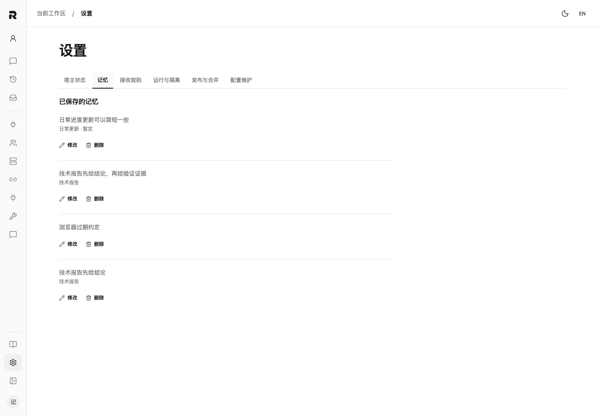

<p align="center">
  
</p>
<h1 align="center">Roppo</h1>

<p align="center"><strong>你的个人 Agent，需要时也是一支团队。</strong></p>
<p align="center">
  <a href="README.md">English</a> · 简体中文<br>
  <a href="#产品演示">观看视频</a> · <a href="#你的工作空间">了解 Roppo</a> · <a href="#快速开始">开始使用</a> · <a href="https://github.com/pythc/agent-hub/discussions">社区</a>
</p>
<p align="center">
  <a href="https://github.com/pythc/agent-hub/actions/workflows/ci.yml"></a>
  <a href="LICENSE"></a>
</p>

**告诉 Roppo 你想完成什么，然后验收结果。** Roppo 是一个开源、本地优先的工作空间，帮助你处理代码、研究、文档和定期任务。你始终与 Router 对话；通常由一个 Worker 完整负责一项任务，需要时再协作。

## 产品演示

[](https://github.com/pythc/agent-hub/raw/refs/heads/main/docs/media/roppo-product-en.mp4)

**[观看英文版 · 2 分 57 秒 · 1080p](https://github.com/pythc/agent-hub/raw/refs/heads/main/docs/media/roppo-product-en.mp4)** — 英文界面与字幕，无旁白。这支概念视频也包含产品的长期愿景；下方截图和交互动图来自运行中的界面，使用隔离演示数据。[素材说明](docs/images/README.md#product-tour-media)。

## 你的工作空间


### 从一句话开始

> “看看这份发布计划，核对里面的数据，给我一份周一能用的简明方案。”

附上材料，发送消息。任务、工具调用和回复都留在同一个对话里；执行期间可以继续补充要求，也可以随时停止。


也可以这样派活：

| 场景 | 试着这样说 |
| --- | --- |
| 修复代码 | “摘要把 emoji 截坏了，修好并补回归测试，把结果给我看看。” |
| 调研比较 | “根据官方资料对比这三个方案，推荐一个适合我们项目的。” |
| 文档核对 | “对照这份文档和表格，列出数据不一致的地方。” |
| 定期任务 | “每个工作日早上九点，汇总未解决的 issue，告诉我哪些需要关注。” |

### 一个对话，两种视图

**群聊模式**把 Router 和 Worker 的发言放在一起。切换到 **Agents 列表**，可以查看每个 Agent 的最近消息与上下文。Worker 的对话只读，派活和追问继续交给 Router。


<picture>
  <source media="(prefers-color-scheme: dark)" srcset="docs/images/product/agents-dark.jpg">
  
</picture>

### 带上文件，把细节讲清楚

上传文档、表格、图片、代码或压缩包；支持多文件选择、拖入文件和粘贴图片。回复支持 Markdown、表格、代码与 LaTeX 公式，原始附件可以继续下载。


每条消息最多 **32 个文件，单文件 100 MiB**。具体格式能否被理解，取决于所选模型和任务工具。[文件与公式 →](docs/CHAT_FILES_MATH_ACCEPTANCE.md)

### 在使用中，逐渐了解你

直接从任务开始，在对话中自然表达你的习惯。Roppo 可以保留有用的偏好和工作上下文，供后续任务使用。在**设置**中可以修改或删除已保存的记忆。需要临时调整某项偏好时，可以设置例外的到期时间，也可以再指定触发它的短语。



Router 和 Worker 都可以自定义名字、模型和工具。在**行为规则**中填写共同偏好与角色指令，保存前可以预览完整提示词。Chat 显示方式和清空内置 Chat 记忆、上下文的操作也都收在设置里。

在**设置 → 外观**中选择浅色、深色或跟随系统，调整主题预设、自定义颜色与对比度、界面/内容/代码字号、减少动态效果、智能标点、对话全宽和差异标记。主题配色可以复制或导入分享。偏好保存在当前浏览器，在其中的 Roppo 页面间生效；升级时保留原来的深浅选择。

可将全部外观设置另存为命名**皮肤**，重命名或删除已保存的皮肤，并通过 `.roppo-skin.json` 文件导入、导出深浅配色与全部高级选项。**视觉风格**右侧的重置图标会恢复当前皮肤的设置，临时调整不会覆盖已保存的皮肤。新浏览器默认跟随系统模式。

<picture>
  <source media="(prefers-color-scheme: dark)" srcset="docs/images/appearance-settings-dark.jpg">
  
</picture>

### 在任务发生的地方接手

通过现有来源适配器和插件连接**飞书、Slack、Linear、GitHub**，通过 **MCP** 和应用集成扩充工具。任务可以关联原来的会话或 issue。

重复工作可以交给定时任务或签名事件自动化，在工作空间查看事件、任务结果和回传记录。定时任务需要主机持续运行。[应用接入](docs/PLUGINS.md) · [定时任务](docs/PROACTIVE_ROUTER.md) · [事件自动化](docs/WEBHOOKS.md)

在 Chat 打开**会话面板 → 定时**，可以暂停提醒、调整排期，或点击上次交付跳到对应消息。轻量提醒会直接发到创建它的会话。在设置的**提醒与方法**中，可以按工作范围查看排期、目标和已保存的方法。


### 浏览器就在任务旁边

Worker 可以使用独立浏览器会话，并复用你授权的登录状态。打开对话旁的浏览器，查看当前页面；网站需要你操作时，可以随时**接管**。文件与团队动态也在同一个侧面板里。[浏览器指南 →](docs/BROWSER.en.md)

## 快速开始

需要 **Node.js 22.19+**、Git，以及一种受支持的模型连接。

```sh
git clone https://github.com/pythc/agent-hub.git
cd agent-hub
npm ci
./start.sh
```

创建本地账号，连接模型，配置托管 Router，并按需添加 Worker，然后打开**对话**。无需注册 Roppo 云端账号，启动器会将个人安装保存在 `~/.agent-hub`。

使用 Docker？启动 Docker 和 Compose 后执行：

```sh
./deployment/compose.sh up
```

这会构建含 Chromium 和 Bubblewrap 的 Linux 运行环境，创建持久数据卷，并打印本地配置链接。[Docker 部署与升级](docs/DOCKER.md) · [重新打开已有安装](docs/OPERATIONS.md#start-the-right-instance)

在项目仓库中运行 `npm link` 安装终端命令，执行 `roppo login` 连接账号。输入 `roppo` 续接网页端的个人对话，终端界面使用英文。`-c` 和 `-p` 默认使用同一段个人对话，Worker 协作留在后台。[Roppo CLI 使用指南](docs/TERMINAL.md)。终端支持可搜索的 `/config`、`/model`、`/effort`、`/permissions`、`/resume` 菜单、主题设置，以及供脚本使用的 `--output-format stream-json`。

## 使用自己的模型

| 接入方式 | 选项 |
| --- | --- |
| 模型 API | 兼容 OpenAI Responses、OpenAI Chat Completions、Anthropic Messages 的端点 |
| 本地 CLI | 原生 Codex app-server，使用主机上已安装、已登录的 Codex |
| 实验性 | 直接登录 ChatGPT；已有协议测试，真实账号验收仍待完成 |

每个 Agent 可以选择自己的连接，只使用 API 时不需要安装 Codex。[模型配置 →](docs/MODELS.md)

## 当前范围

Roppo **面向个人使用，仍在持续开发**，每个部署支持一个本地个人账号。组织身份、角色和多租户访问属于后续规划。数据与运行状态保存在本地；调用外部模型和应用时，按你配置的连接发送请求。不同适配器与服务商的接入要求、可用工具有所不同。

## 文档

| 开始使用 | 深入了解 |
| --- | --- |
| [Chat](docs/CHAT.md) · [模型](docs/MODELS.md) | [配置](docs/CONFIGURATION.md) · [执行后端](docs/BACKENDS.md) |
| [浏览器](docs/BROWSER.en.md) · [插件](docs/PLUGINS.md) | [插件开发](docs/EXECUTION_PLUGINS.md) · [Webhooks](docs/WEBHOOKS.md) |
| [Docker](docs/DOCKER.md) · [运行维护](docs/OPERATIONS.md) | [架构与核心来源](docs/PARITY.md) · [路线图](docs/ROADMAP.md) |

## 一起改进 Roppo

带来一个真实工作场景、报告问题，或者提交改进。欢迎使用中文或英文交流。

[讨论区](https://github.com/pythc/agent-hub/discussions) · [报告问题](https://github.com/pythc/agent-hub/issues/new/choose) · [贡献指南](CONTRIBUTING.md) · [社区指南](docs/COMMUNITY.md) · [行为准则](CODE_OF_CONDUCT.md) · [安全问题](SECURITY.md)

## 许可证与致谢

Roppo 基于 [DeepSeek Super Agent](https://github.com/deepseek-ai/dsh-superagent-prototype) 的领域核心构建，增加了持久 Router、工作空间、适配器和浏览器集成。Roppo 是独立项目，具体来源与扩展范围见[架构说明](docs/PARITY.md)。

项目采用 [Apache-2.0](LICENSE) 许可证。第三方组件保留各自许可证，包括采用 MIT 的 DeepSeek 核心。感谢 [assistant-ui](https://github.com/assistant-ui/assistant-ui)、[agent-browser](https://github.com/vercel-labs/agent-browser)、React、Vite 和 MCP SDK。[NOTICE](NOTICE) · [第三方许可证](THIRD_PARTY.md)

仓库和 CLI 继续使用 `agent-hub` 名称。
