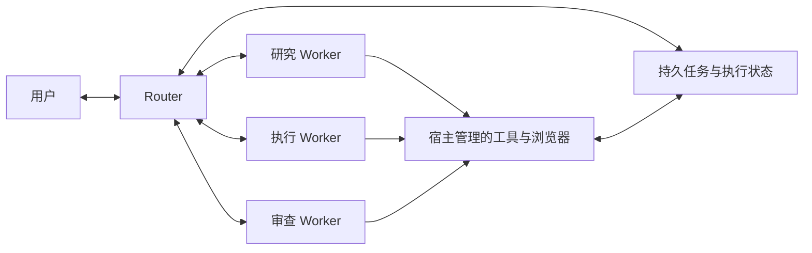

# Roppo

**一个对话，一支 Agent 团队，你自己的工作区。**

[English](README.md) · [简体中文](README.zh-CN.md)

[](https://github.com/pythc/agent-hub/actions/workflows/ci.yml)
[](LICENSE)
[](package.json)
[](https://github.com/pythc/agent-hub/discussions)

Roppo 是一个本地优先的多 Agent 工作区。你向 **Router** 提出目标，由它组织工作、委派 **Worker**，再将结果带回同一个对话。文件、浏览器、工具调用和团队动态都围绕当前任务展开。

Roppo 基于 [DeepSeek Super Agent 原型](https://github.com/deepseek-ai/dsh-superagent-prototype)的领域核心，加入个人工作区、可配置的模型连接和持久执行能力。仓库与 CLI 暂时沿用 `agent-hub` 名称。

[开始使用](#开始使用) · [运行方式](#运行方式) · [文档](#文档) · [参与社区](#参与社区)


*实际运行的界面，使用隔离的演示数据；截图中的模型名称与结果来自测试 fixture。*

## 围绕任务组织的工作区

- **只需与一位协调者对话。** Router 沟通和分派，Worker 执行并向 Router 报告。你可以追问、停止运行或人工接管。
- **每个角色独立配置。** 为 Router 和 1–10 个 Worker 分别选择连接、模型、提示词、思考选项、厂商参数及工具。
- **过程可见。** 接收流式回复，查看真实工具调用和团队动态；保留失败及中断记录。
- **在会话中使用浏览器。** 保留个人登录状态，在本地加密账号库保存密码，并明确授权 Worker 复用所需登录信息。
- **跨会话保留工作。** 对话、任务、执行历史和恢复状态保存在自己的宿主中；结果不确定的外部操作先核对，再重试。
- **接入已有工作入口。** MCP 客户端、飞书、企业微信、GitHub 和自定义来源适配器可连接同一宿主。

界面提供中英文、黑白主题、可折叠的会话列表，以及可关闭的文件、浏览器、团队动态标签页。

<details>
<summary>查看白色主题与工具入口</summary>


</details>

## 开始使用

准备 **Node.js 22.19 或更高版本**、Git，以及一个可用的模型后端。使用 Roppo 无需注册官网账号。

```sh
git clone https://github.com/pythc/agent-hub.git
cd agent-hub
npm ci
./start.sh
```

1. 在自动打开的浏览器中创建本地账号，保存恢复码。
2. 在「模型连接」添加后端。
3. 在「Agent 团队」选择托管 Router，并配置 Worker。
4. 点击「新建会话」，向 Router 提交任务。

启动器会构建前端并打开本地工作区。默认安装目录是 `~/.agent-hub`，再次运行会复用已有实例。记住登录后，有效期内重启宿主仍可继续使用。指定独立目录、不自动打开浏览器：

```sh
./start.sh setup /path/to/private-directory --no-open
```

已有部署继续使用原配置和状态目录：

```sh
./start.sh serve /path/to/config.json
```

### 使用自己的模型服务

| 接入方式 | 已实现的适配器 | 所需条件 |
| --- | --- | --- |
| 模型 API | OpenAI Responses、OpenAI Chat Completions、Anthropic Messages | 兼容端点、可用模型和凭据 |
| 订阅 | ChatGPT 登录适配器 | 符合服务商条件的账号；可用性和额度规则由服务商决定 |
| CLI | 原生 Codex app-server | 宿主已安装 Codex，并完成认证 |

纯 API 部署不需要安装 Codex。CLI 使用其自身配置的认证与计费方式。直接 ChatGPT 登录已覆盖协议回归，但**尚未完成真实账号登录和推理验收**，不能与原生 Codex 实测混为一谈。其他厂商订阅和 CLI 仍需新增适配器。

思考控制取决于具体模型；不支持的参数会明确报错，不会被静默替换。详见[模型连接](docs/MODELS.md)和[独立 Agent 配置](docs/AGENT_CAPABILITIES_2026-11-06.md)。

### 启用内置浏览器

macOS 可以使用已安装的 Google Chrome。其他情况可以安装浏览器运行时，或设置 `browser.executablePath`：

```sh
npx agent-browser install
```

在会话中创建浏览器资料，登录网站，再选择哪些 Worker 可以复用登录状态。每个任务分配有独立的可写浏览器会话；点击「接管」后，Worker 会暂停控制，直到你交还。

密码保存在 Roppo 本地加密账号库，不会导入日常 Chrome 密码管理器。同一网站账号的多个浏览器仍可能影响相同的服务端数据。详见[浏览器指南](docs/BROWSER.md)。

## 运行方式



宿主明确记录任务准入、分配、追问、报告和交付状态。收到请求不等于完成任务，工具进入队列也不等于调用成功。用户与 Router 沟通，不另设用户直接向 Worker 发消息的流程。

Roppo 保留 DeepSeek 原型固定提交 `8c32a9dc5d72c033816c6a8110b37f40cf94fba4` 的 15 个领域核心文件。工作区、持续 Router、后端适配器和浏览器属于 Roppo 扩展；核心一致不等于模型行为相同，也不代表完整上游集成等价。详见[原型对照](docs/PARITY.md)与[第三方声明](THIRD_PARTY.md)。Roppo 是独立项目，不是 DeepSeek 官方产品。

## 当前状态与边界

项目正在持续开发，当前优先支持**个人使用**：每个部署一个本地账号。组织身份、租户隔离和企业权限体系尚未作为完整产品实现。

- 宿主监听本机 loopback，远程使用需要单独配置安全连接。
- 模型请求会发送给选定的服务商；本地优先指工作区及状态由自己掌握，不代表离线推理。
- 内置浏览器已在 macOS + Chrome 验证。Linux 沙箱有独立验收；Linux、Windows 的完整浏览器验收仍待补齐。
- 数据库备份不包含全部个人凭据、浏览器资料和工作目录。升级或迁移前请阅读[运维与备份](docs/OPERATIONS.md)。

## 文档

| 使用 | 深入了解 |
| --- | --- |
| [个人账号](docs/PERSONAL_ACCOUNT.md) | [模型后端](docs/BACKENDS.md) |
| [站内对话](docs/CHAT.md) | [原型对照与任务语义](docs/PARITY.md) |
| [内置浏览器](docs/BROWSER.md) | [来源与工具适配器](docs/INTEGRATIONS.md) |
| [MCP 客户端](docs/clients/README.md) | [办公平台接入](docs/OFFICE.md) |

## 开发与贡献

```sh
npm ci
npm run check
```

`check` 检查宿主与前端类型、构建页面并运行回归测试。浏览器验收、真实模型验收单独执行，不能由单元测试替代。开发流程见[贡献指南](CONTRIBUTING.zh-CN.md)。

宿主代码位于 `src/`，React 会话工作区位于 `web/chat/`，共享管理界面位于 `src/ui/`，回归测试位于 `tests/`。更新 vendored 领域核心时，需要明确记录上游版本与差异。

## 参与社区

欢迎用中文或英文交流和贡献：

- 在 [Discussions](https://github.com/pythc/agent-hub/discussions) 提问、分享用法、讨论方向。
- 通过 [Issue 模板](https://github.com/pythc/agent-hub/issues/new/choose)报告可复现问题或提出功能需求。
- 从[贡献指南](CONTRIBUTING.zh-CN.md)开始，改进文档、界面或适配器。
- 阅读[路线图](ROADMAP.md)、[社区指南](docs/COMMUNITY.md)及[行为准则](CODE_OF_CONDUCT.md)。
- 敏感问题请按[安全报告流程](SECURITY.md)私下提交。

## 许可与致谢

Roppo 原创代码采用 [Apache-2.0](LICENSE)。第三方代码保留原许可证，例如 DeepSeek 领域核心采用 MIT。详见 [NOTICE](NOTICE) 与 [THIRD_PARTY.md](THIRD_PARTY.md)。

感谢 [DeepSeek Super Agent](https://github.com/deepseek-ai/dsh-superagent-prototype)、[assistant-ui](https://github.com/assistant-ui/assistant-ui)、[agent-browser](https://github.com/vercel-labs/agent-browser)、React、Vite、MCP SDK 及其维护者和贡献者。
