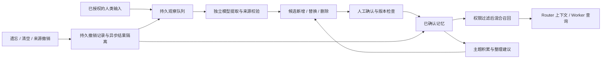

# AgentHub 长期记忆

新增的 `adaptive` 模式、渐进冷启动、带适用条件的偏好、验收经验与格式 3 升级说明见 [在任务中学习协作偏好](PERSONAL_MEMORY_ADAPTATION.md)。下文的全部候选确认流程描述既有 `auto` 模式；新模式可自动启用工作偏好和有验收来源的经验，其他事实与删除建议仍需确认。

本轮把 WeKnora 的提取、候选更新、召回、整理、主题积累与遗忘生命周期融入 AgentHub，按现有 Router / Worker、来源权限和持久状态重新实现。研究基线是 WeKnora `e3fb2335bf3f8cadd32142380c60b2677a27bf99`；本轮没有新增复制上游实现。此前已有的 `vendor/weknora/primitives.ts` 继续提供基础文本能力。

记忆提供带来源的背景。原始目标、授权范围、依赖图、验收规则及完成状态仍由现有任务系统管理。记忆提取、确认和整理均不直接修改这些契约。



| 能力 | 实现与约束 |
| --- | --- |
| 输入与提取 | 接入真实 ingress。观察记录保存来源版本、scope、entry、actor、讨论线程、序号、generation、epoch、状态和 lease。单批至多 20 段、约 24,000 字符；长输入按 12,000 个 Unicode 字符切段。 |
| 写入策略 | 默认 `explicit_only`。明确的短“记住”指令直接生效并保护；`auto` 模式的模型输出全部进入候选。抽取只使用用户消息，要求精确来源引文和合法目标索引。 |
| 分类 | 画像、偏好、事实、任务背景、兴趣。任务背景不等于任务状态。画像、偏好与兴趣额外按 actor 过滤；群事实仍遵循既有入口和显式发布规则。 |
| 更新与删除 | 候选保留替换目标及 revision，旧记忆一直有效到确认。确认时重新检查来源、权限和版本；拒绝直接或间接依赖替换目标的提案，避免替换后自我失效。删除同时持久遗忘目标和提案。 |
| 恢复 | 未完成 lease 在重启后重新排队；写入结果、处理状态及游标在同一事务提交。仍获授权的旧 epoch 输入会重新捕获当前上下文；generation 或来源失效不能刷新复活。 |
| 失败与节流 | 默认延迟 90 秒、成功提取最小间隔 5 分钟。积压批次也重新检查间隔。失败最多尝试 3 次后保留待处理段，不跳过后伪称完成；其他会话可以推进。每 scope 的 UTC 日预算默认 100 次，由提取、整理和可选召回证据验证共享，失败调用也计入。 |
| 模型隔离 | 抽取、整理和召回证据验证使用独立、只读、无工具的临时模型调用，且 backend 必须在 scope 许可内。API 后端支持临时调用，不额外保留 `backend-thread` 输入，也不注入历史召回工具。模型供应商自己的留存不由本地宿主保证。 |
| 混合召回 | 在权限过滤后的集合内做词法与向量排名融合；画像、偏好和明确记忆有常驻预算，额外选取相关项。模型查询和索引维护有超时；接口不可用或索引不完整时返回明确降级状态。 |
| 敏感文本 | 启发式识别常见凭据格式：禁止写成记忆；自动观察被保留为待处理；不会把识别到的敏感查询或旧事实发送给 embedding 服务。该检查不替代完整的秘密识别系统，也不删除原始会话。 |
| 主题 | 按不同讨论线程累计，默认 3 个独立线程后提出兴趣候选。同一线程反复讨论不增加会话数。模型可归一别名；遗忘只保留内容无关的哈希抑制，重启／恢复旧数据库后仍有效。 |
| 整理 | 词法与现有向量选择相关候选，模型提出合并建议，等待确认；自动整理按天节流。未保护的任务背景 45 天未使用可降低重要性。默认每 actor / entry / 状态容量 200，自动归档不淘汰人工确认的保护项。 |
| 知识检索 | Router 生成知识查询时已获得受控记忆。另记录实际回复明确引用的文档 ID 与版本；同一入口／actor 的重复使用最多提供 15% 排序加成，不扩大文档权限。 |
| 证据 | 上下文和 Worker 查询绑定事实及来源 revision；使用前后检查当前权限。禁用、撤销或变更后，旧 manifest 不能继续作为有效记忆使用。发布单条事实不会额外发布其原始消息全文或未发布的历史版本。 |

工作台入口是 `/memory-workbench`，也可从“Router 与记忆 → 长期记忆”进入。页面接入真实后端，支持学习设置、分类筛选、关键词与混合召回、候选前后对照、确认／拒绝、编辑、来源与历史、归档恢复、待处理重试、主题遗忘和范围清空。未配置 embedding 接口时使用词法召回。管理页沿用本机 operator 权限，不能冒充私有入口中的消息作者；私有入口使用其实际来源身份。

实现入口为 `src/agent-memory.ts`、`src/memory-learning.ts`、`src/memory-policy.ts` 与 `src/memory-vectors.ts`；既有 `router-memory.ts` 继续负责来源、版本、发布及内容无关的撤销日志。Router 和 Worker 都通过受控查询路径使用记忆。暂停使用会保留存储；清空与遗忘不等于删除会话历史或供应商副本。

可选 `reranker:{url,model,apiKeyEnv?,minScore,candidateLimit}` 接入 query-document 相关性重排，实现在 `src/memory-rerank.ts`。配置完整 rerank 接口地址，模型返回完整 indexed `[0,1]` 分数；分数适合排序，并不等同于“能够回答问题”的概率。未启用下述验证时，仍按配置的 `minScore` 筛选；默认 0.5 不代表所有模型都适用。候选默认 20、最多 40，重排超时 5 秒。候选限于当前授权记忆；无 embedding 时只有词法候选。embedding 和重排不计入记忆模型日预算。关闭宿主会取消并等待查询。

可选 `verifyRelevance:true` 启用独立证据验证，工作台“容量、预算与语义检索 → 验证召回证据”可以配置。`src/memory-relevance.ts` 复用当前记忆模型选择链（策略 `extractBackend` / `extractModel`，继承 scope / Router 默认），把授权候选与问题交给模型逐项判断是否包含同一对象、所问事项的实际证据。模型不接收重排分数；此模式忽略 `minScore` 的过滤作用，只用重排排序。输出必须覆盖全部候选索引，支持项必须附有记忆正文内的精确非空引文。主机检查引文出处，语义相关性仍是可能出错的模型判断。不会因此写入、确认或删除记忆，也不修改任务目标、授权和验收标准。

验证输入上限 256,000 字节，单次期限 60 秒。默认至多 20 项（配置 reranker 时沿用其候选上限），未检出的候选仍不能凭空补回。校验失败、超时、预算耗尽会返回 `partial`，并关闭这次相关项召回；不会退回未经验证的相关项。重排或 embedding 降级时仍可验证已有候选，但整体状态保留 `partial`。该门禁只覆盖相关项，已授权的画像、偏好、明确记住的常驻上下文仍有单独预算。结果缓存至多 60 秒，事实、来源、权限或策略变化会使结果失效；进程重启后重新验证。准备阶段目前没有接入每轮任务的取消信号，关闭宿主可以取消，单轮取消可能等待调用期限。

每次非空且未命中缓存的验证会增加一次模型调用，与提取、整理共享 scope / UTC 日预算；提取前的检索准备也可能触发验证，不能按“每条用户消息只增加一次”估算成本。超出输入上限、无候选或命中缓存不发起验证调用。默认不启用，不自动更改现有实例。完整对照、真实模型延迟、回滚验证和剩余边界见 [证据验证记录](MEMORY_RELEVANCE_VALIDATION_2026-11-08.md)。

本轮两条漏召回修复、独立 88 问对照、延迟、剩余误差和回退步骤见 [检索验收记录](MEMORY_RETRIEVAL_VALIDATION_2026-11-08.md)。这些效果需要显式配置并启用重排，没有自动修改现有实例。回退至尚不认识 reranker 的版本前，必须先用新版移除该策略字段；已用隔离状态副本验证事实保留。

回退到本次修复基线 `3db35f3` 前，先在新版关闭“验证召回证据”，确认持久策略已**移除** `verifyRelevance`，再停止宿主并切换旧代码；保存 `false` 也不足以兼容旧版严格 schema。该回退保留 reranker、事实和来源，不需要降级数据库。更早版本的 reranker / 数据库约束仍分别适用。

升级时首次成功初始化记忆生命周期会把 SQLite `user_version` 提升到 **7**，记忆格式标记为 2。旧版宿主会拒绝打开 schema 7，避免把替换候选当作普通事实处理。升级前应在宿主停止后做既有 `backup`，保留完整 state、托管配置及撤销日志。需要回退时使用升级前备份和兼容程序；升级后的新任务、输入、外部效果或撤销记录不可通过简单覆盖丢弃。当前恢复流程保留原有推进／外部效果检查，未来 schema 会被拒绝。

可复现测试：

```sh
npm run typecheck
npm test -- --maxWorkers=4

# 使用真实配置的 Codex CLI；每次指定全新目录。
AGENTHUB_CODEX=/path/to/codex \
MEMORY_ACCEPTANCE_DIR=/tmp/agenthub-memory-native \
node --import tsx examples/agent-memory-smoke.ts

# 启动隔离的真实 HTTP/SQLite 工作台，再在另一终端跑浏览器脚本。
MEMORY_BROWSER_DIR=/tmp/agenthub-memory-browser \
node --import tsx examples/agent-memory-browser.ts
MEMORY_BROWSER_DIR=/tmp/agenthub-memory-browser \
python3 tests/browser/agent-memory.py
```

浏览器脚本需要已有 Playwright Python 环境和 Chromium。原生提取测试会在模型调用已开始后终止自己创建的独立测试进程组，再用新的进程恢复，随后验证确认、更新、跨会话使用及清空后重启。所有场景都使用隔离目录与合成内容。

本轮验收详情与范围见 [AGENT_MEMORY_VALIDATION.md](AGENT_MEMORY_VALIDATION.md)。这不是外部 WeKnora 服务接入，Wiki 能力已按用户要求移除并清理运行库数据，见 [Wiki 移除说明](WIKI_REMOVAL_2026-11-09.md)；Agent 记忆能力保留。已用 Potion 和 BGE 的本地真实权重验证 embedding 索引、混合召回、重启、遗忘及降级；小规模合成样本仍有漏召回，实际业务语料和线上服务仍需独立验收。

整理过程被中断后，启动恢复为 `interrupted`。自动模式会重新检查当前权限和记忆开关再调度；显式模式需要重新发起人工整理。恢复不会自动确认候选，也不会跳过每日模型预算。合并候选与完成回执在同一事务提交，关闭宿主会取消并等待人工／自动整理。

补充复跑脚本（均使用新的隔离目录）：

```sh
MEMORY_CONSOLIDATION_DIR=/tmp/agenthub-consolidation-acceptance \
  AGENTHUB_CODEX=/path/to/codex \
  node --import tsx examples/agent-memory-consolidation.ts

MEMORY_SEMANTIC_DIR=/tmp/agenthub-semantic-acceptance \
  MEMORY_EMBEDDING_PYTHON=/path/to/isolated/python \
  MEMORY_EMBEDDING_SNAPSHOT=/path/to/cached/potion/snapshot \
  node --import tsx examples/agent-memory-semantic.ts
```

第二条默认需要 Model2Vec 0.10.0 与 Potion 权重。BGE 复跑时设置 `MEMORY_EMBEDDING_ENGINE=transformers`、`MEMORY_EMBEDDING_MODEL=BAAI/bge-small-zh-v1.5`，并选择装有 Transformers / PyTorch 的解释器与对应权重目录。适配器仅用于合成数据验收，绑定 loopback；其统计及故障注入接口没有鉴权，不应作为生产 embedding 服务。原生模型崩溃脚本使用 POSIX 进程组。
