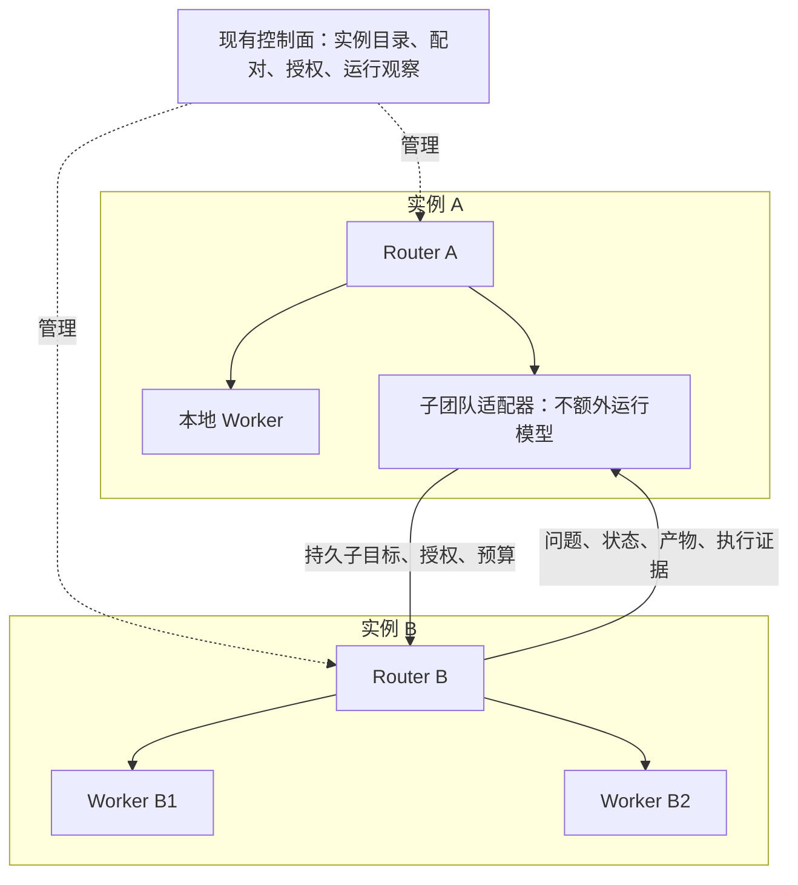

# Roppo 部署方式、跨实例委派与控制面改造方案

日期：2026-11-09。状态：原始设计归档，已由 [收尾记录](DELEGATION_CLOSEOUT_2026-11-09.md) 收敛范围。

**最新决定：不实施跨机器部署，也不实施 Worker 直接统筹另一实例 Workers 的 `delegated-coordinator`。** 当前交付只保留同一所有者、同机一跳 `managed-team`、结构化目标及独立验收。正文保留原始分析和被取消的设计，不能视为当前路线或运行事实。

实际用法见 [委派说明](DELEGATION.md)，历史首期和第二阶段证据分别见 [首期验收](DELEGATION_ACCEPTANCE_2026-11-09.md)、[目标改造](DELEGATION_GOALS_2026-11-09.md)。当前实例、部署方式及升级边界见 [部署现状](DEPLOYMENT_STATUS_2026-11-09.md)。下面的早期 checkout / release 观察已过时；运行实例没有由本轮改造切换。

## 1. 当前基线与已有部署方式

本轮检查的 checkout 为 `2f695dde7743052757f72ed89d768ca9a12ba0f4`；2026-11-09 14:42（北京时间）只读回查的运行 release 为 `b4f4b65cb9a0578cc06772d3c032e8139407e343`，采用 `supervise`。宿主健康返回 `ok: true`、版本 `0.10.0`，设置 revision 为 11，Router 为 host 模式，4 个本地 Worker，无活动 Worker，也没有出站工具连接。

这些是带时间的观察，不是持续运行保证。运行 release 比该 checkout 更新，另含执行后端插件和仓库来源续接变更；相关差异已经检查。实施应在包含这些已交付变更的集成基线上创建独立工作树，不能把旧 checkout 直接覆盖到现有部署。实施前重新核对 HEAD、未提交修改、实际 release、设置 revision、插件和活动工作。

整理期间该工作区随后出现并行源码与测试改动，未由本方案审查或纳入固定基线。本次只新增本文，实施时以重新确认的集成结果为准。

| 维度 | 已有能力 | 证据及边界 |
| --- | --- | --- |
| 本机个人安装 | `setup` 创建或复用独立安装，`serve` 使用已有配置 | 默认一个部署对应一个本地账号；账号不是企业租户隔离边界 |
| 常驻与监督 | `supervise` 运行宿主和独立 Watchdog | 本机 LaunchAgent 已只读确认活动；单独 `serve` 不等于安装了监督服务 |
| Linux 主机 / VM | Node、Bubblewrap、运行与沙箱验收，systemd 模板 | 现有记录有特定 Linux VM 验收，systemd 模板未有实机启动验收证明 |
| 同机多实例 | 不同配置、端口、状态目录可独立运行 | 不能共享可写 stateDir；没有由此形成统一调度或高可用 |
| 外部客户端 Router | MCP `worker_manage` 与 client Router 模式 | 客户端管理宿主 Workers；这不是跨实例权限传递协议 |
| 本地嵌套执行 | `superagent_spawn`、本地深度和并发限制 | 子代理仍属于同一宿主及 assignment；限制不会自动覆盖另一实例 |
| 跨实例接口基础 | 出站 MCP tools；入站 `agent_request`、`worker_manage` 等 | 可用于适配验证；本轮未做两个 Roppo 实例之间的任务实测 |
| 容器 | Linux 验收 Dockerfile | 镜像启动运行测试，不能当作正式运行镜像或默认容器策略验收 |

模型 API、Codex、直接订阅及执行后端插件是“如何推理 / 执行”的维度，可以与部署位置组合。调用远端模型 API，不等于把 Worker 的文件、浏览器或命令运行位置移到了远端。

代码和说明入口：[OPERATIONS](OPERATIONS.md)、[LINUX](LINUX.md)、[客户端接入](clients/README.md)、[Worker 配置](../src/backend-config.ts)、[子代理](../src/work.ts)、[MCP 桥](../src/mcp.ts)、[工具连接](../src/tool-connections.ts)。

## 2. 对象定义与部署拓扑

| 对象 | 含义 | 应与什么区分 |
| --- | --- | --- |
| 宿主机器 Host | 个人电脑、VM、服务器或容器所在环境 | 一台机器可以运行多个 Instance |
| 运行实例 Instance | 独立身份、配置、进程、持久状态和凭据边界 | 进程重启不产生新身份；复制安装用于新实例则必须重新生成身份 |
| Agent 团队 Team | Router 及其可调度的执行资源 | 首期每个实例导出一个受限团队，不要求先实现组织或多个工作区 |
| 本地 Worker | 当前实例通过执行后端运行的执行者 | 其模型后端可以远程，但执行资源仍由当前宿主提供 |
| 子团队目标 TeamTarget | 当前 Router 可委派子目标的另一个团队 | 不是一个模型后端，也不等于拥有对方整个实例的管理权限 |
| 管理范围 Scope | 当前已有的任务归属、来源和资源授权范围 | 不从界面名称推导成已完成的多用户、组织或租户产品 |
| 委派 Delegation | 一个父任务将有界子目标交给一个目标团队的持久关系 | 连接可供多个任务复用；每个任务的授权、预算和控制代次独立 |

部署拓扑与角色分工分开设置。先支持同机两个独立实例，再验收 Mac 与 Linux 的跨机器组合。每条任务链只有一个当前协调负责人；同一个实例可以服务多个任务，不能因此共享它们的上下文和控制权限。

首期默认 `maxDelegationHops = 1`：根实例为 hop 0，子团队为 hop 1，即两层实例。它与现有本地子代理 `work.maxDepth` 分别计数。以后放宽远程跳数时，沿委派链携带不可重写的祖先实例标识，同一链拒绝 A → B → A；不同任务之间是否互相服务不由这个限制一概禁止。

## 3. 协作方式的原始设计（仅 3.1 交付）

### 3.1 默认：独立子团队统筹 `managed-team`

A 的 Router 定义子目标、授权上限、输入和验收条件，B 的 Router 自行分派 B 的 Workers。B 通过内部委派通道返回问题、进度和候选结果，A 对父任务验收并向原用户汇报。

连接适配器直接处理协议，不为转发请求额外创建模型 Worker。B 在原合同与有效租约内继续执行，不要求 A 的控制页面一直打开。A 暂时不可达时，B 保留状态和结果，不能据此扩大任务或无限续租。



### 3.2 已取消：当前 Worker 统筹远端资源 `delegated-coordinator`

A 的某个 Worker 在自身任务范围内，担任 B 上某次委派的协调者；该委派不再启动第二个 B Router 模型。这样更贴近“Worker 同时是另一实例的 Router”的表达。

实现为任务级协调会话：B 为该会话提供收敛后的 Worker 管理能力，并持续校验授权。不能直接向 A 的 Worker 暴露 B 的操作员 `worker_manage`；也不能为了一次委派全局切换 B 的 `execution.router.mode`。B 的其他独立任务仍由它们原有的 Router 负责。

这一方式需要专门验证协调者重启、原生模型会话恢复、等待时的调度占用、权限撤回和接管规则，放在默认子团队闭环之后。现有客户端 Router 能力保留，不自动迁移成新模式。

两种方式由连接能力和目标配置共同确定。已有任务固定其方式、目标实例、合同和会话绑定，修改默认设置只影响新任务。

## 4. 控制面、任务执行与插件的职责

控制面负责实例目录、配对、授权策略、配置计划、版本兼容性、运行观察和操作审计。首期由现有宿主提供这些管理接口，不新增一个必须常驻的中央控制服务。

各实例继续拥有自己的任务状态、模型会话、工具回执、工作文件和出站投递。跨实例适配器负责提交、对账、状态拉取、控制传播和产物传输。浏览器只访问当前宿主的同源接口，不持有对方的凭据，也不直接访问任意远端管理 API。

首期采用宿主后台的有界状态轮询，保留下一次检查时间和事件游标；等待过程不让模型循环查询。后续订阅 / 推送只是通知加速，持久任务和对账接口仍是恢复依据。

只有需要协调的状态转换、问题和交付唤醒 Router；重复事件、纯进度刷新和空轮询不触发模型。事件带单调序号，分页绑定状态版本；重连先取得当前快照，再补齐可恢复事件，缺失历史明确标记为不完整。

新增能力归于宿主的任务委派层。执行后端插件仍解决模型 / CLI 适配；Source plugin 仍解决来源消息和资源；Agent 看板等 Workspace view 仍为受限只读展示。三者不能通过新增一个工具或页面自行取得跨实例控制权。15 个上游领域核心文件保持原样。

Router 通过拟新增的宿主管理工具 `team_delegate` 发现获准目标并委派、查看、跟进和控制工作。`list` 返回当前范围内的目标、能力和 revision；修改使用稳定操作 ID 与期望版本，父任务、主体和授权从当前 Router 上下文取得，不能由模型自报。配对、扩大连接权限和远端系统运维保留为操作员控制能力，不包含在普通委派工具中。

结构化目标节点增加目标引用，由宿主调度；已在目标图中声明的节点不能再通过工具手动重复委派。高级协调方式另提供绑定到单次 assignment 的受限协调工具，普通 Worker 不默认获得它。原生会话恢复后仍须使用当次有效的工具 schema 和授权，不能依赖旧动态工具历史继续控制对端。

## 5. 配置、身份与持久记录

以下名称为拟定接口，实施时统一命名并通过类型检查，不是可直接导入当前版本的配置模板。

### 5.1 保留本地配置，单独增加子团队目标

- 保留 `execution.workers` 的现有含义、必填后端、1–10 个本地 Worker 限制和 `normalizeWorkerCount` 行为。
- 新增 `execution.teamTargets`，记录目标 ID、连接引用、远端团队引用、协作方式、接单状态、并发与预算策略引用。
- 运行时引入 `ExecutionTargetRef`：本地 `{ kind: 'worker', workerId }`，子团队 `{ kind: 'team', teamTargetId }`。任务节点绑定其中一种，不能同时选择两种。
- 子团队数量不改变本地 `concurrency`；远端并发配额独立计算。避免把团队伪装成一个 `backend`，或按远端 Worker 总数修改本地池。
- 新增实例连接和委派监听配置。监听、证书路径等部署字段与动态目标 / 授权策略分开，提供明确的重启提示。

首次启用时生成独立的实例身份和密钥并持久保存，普通重启、切代码与恢复原实例时保留。克隆备份用于新实例必须经过独立的“创建新实例身份”流程，不能让两台机器持同一身份同时接单。备份恢复与克隆用途需要在操作计划中区分。

管理修改沿用 `expectedRevision + operationId`；跨端操作分别检查各端 revision，不假装存在全局事务。未显式修改的模型、提示词、思考、来源和插件设置全部保留，继续满足 `patchSchema.parse({})` 为空对象。

### 5.2 建议的持久对象

| 对象 | 必要内容 |
| --- | --- |
| InstanceIdentity | 稳定实例 ID、公开密钥 / 指纹、密钥版本、创建信息；私钥独立保管 |
| InstanceConnection | 对端身份固定值、传输端点、可信证书、已协商协议 / 能力、revision、撤销代次 |
| TeamTarget | 连接与团队引用、方式、接单策略、预算和并发上限 |
| DelegationContract | 根任务、父任务、原始主体证明、目标与验收、输入摘要、权限、预算、期限、祖先链、合同摘要 |
| RemoteAssignment | 本地 assignment、委派 ID、对端子任务 ID、固定目标身份、控制代次、状态版本与事件游标 |
| DelegationReceipt | 稳定操作标识、请求指纹、接收 / 完成回执和待对账原因 |
| DelegationOutbox | 待提交输入、控制和租约操作，重试时间与已确认游标 |
| ArtifactReference | 产物 ID、版本 / SHA-256、类型、大小、所属委派、可读授权和完整性状态 |

可以复用现有 Store 的事务和记录机制，但“能保存 JSON”不代表旧代码会处理新增作业。新记录与协议都需要版本。是否提升数据库 schema，实施时依据最终持久格式与旧程序能力确定，不在此虚构一个已分配版本。

P1 不自动清理未结束委派及其去重、控制屏障和待确认记录。终态清理另定保留策略，覆盖重试与对账窗口；即使正文因授权撤回而不可读，也保留必要的拒绝重放标识，不能清理后让迟到提交重新开工。

一旦启用新协议或保留未结束的远端工作，必须有能被旧程序识别的启动门禁。实施须证明当前旧版本会拒绝不兼容库；若做不到，首次写入相关状态前提升其可拒绝的 schema 版本，不能只写一个旧程序会忽略的能力字段。

## 6. 委派协议与提交恢复

### 6.1 专用服务身份与传输

当前浏览器管理服务绑定回环地址，并校验本机 Host / Origin。保留这些边界。新增独立、可关闭的委派服务入口，使用专用服务身份验证，不能靠把现有管理端口改成公网监听完成互联。

同机首期可使用回环传输；跨机器版使用 HTTPS、双向身份校验与固定对端身份。优先验收直连受控网络，NAT 出站连接器和其他桥接方式后续增加。即使通过隧道，也必须验证服务身份，不能把隧道可达等同于取得委派权限。

配对由两端操作员发起 / 确认：一次性、短期配对材料，校验对端身份挑战，再分别保存连接和授权。失败、超时和重复提交保留操作回执。目标 URL 不能含凭据；重定向不自动跟随；端点变更需要重新验证。凭据和私钥通过本地引用保存，不进入前端投影、普通日志或公开配置示例。

### 6.2 最小服务操作

下列路径为提案。除最小配对发现信息外，均要求服务身份和当前委派授权；不能复用 `/request` 的本地操作员身份假设。

| 操作 | 建议形式 | 回执要求 |
| --- | --- | --- |
| 协议与能力发现 | `GET /delegation/v1/capabilities` | 协议版本、支持方式、控制能力、产物和限额能力；不包含密钥或任务内容 |
| 提交子目标 | `POST /delegation/v1/tasks` | 子任务和去重映射持久化后才返回任务句柄 |
| 按原请求对账 | `GET /delegation/v1/submissions/{delegationId}` | 在获准连接及主体范围内找到原任务或明确返回不可确认 |
| 查询状态 / 事件 | `GET /delegation/v1/tasks/{id}` | 状态 revision、按游标分页事件及数据完整性标记 |
| 跟进输入 | `POST /delegation/v1/tasks/{id}/inputs` | 稳定操作 ID、输入序号、授权依据与原合同匹配 |
| 暂停 / 恢复 / 取消 | `POST /delegation/v1/tasks/{id}/control` | 控制代次、请求已受理与实际执行结果分别报告 |
| 更新租约 | `POST /delegation/v1/tasks/{id}/lease` | 只能在原合同和有效授权内续期，不能顺带扩大权限 |
| 读取产物 | `GET /delegation/v1/tasks/{id}/artifacts/{artifactId}` | 受限读取、大小 / 类型 / 摘要、分页或范围读取与授权检查 |

能力声明与实际验收分别记录。不支持暂停、某种预算或某种传输时明确拒绝，不降级成含义不同的行为。

`remoteTaskId` 是 B 为本次委派持久创建的任务句柄，不等于某个 Worker ticket、assignment 或模型 thread。B 可以在接收后由 Router 继续分解多个本地任务；状态投影保留各层映射。接收句柄仅证明持久受理，不证明 Router 已决策、Worker 已开工或目标已完成。

### 6.3 提交顺序与幂等

1. A 校验当前父任务授权，生成稳定 `delegationId` 和提交操作 ID，在事务中保存不可变合同、提交意图和 outbox。
2. B 校验来源身份、授权收敛、祖先链、预算和合同摘要，以“发送实例 + 委派 ID + 操作 ID”为去重范围。相同键和内容返回原句柄，不同内容拒绝。
3. B 在本地事务中保存入站回执、子任务关联和待执行作业，再确认接收。它用专用委派来源 / 主体建任务，不把请求转成任意本地操作员的输入。
4. A 保存子任务句柄，并由后台拉取实际状态。断线、提交超时或 A 在保存句柄前崩溃时，使用原标识对账；不能换新 ID 重建任务。
5. 对账确认存在则继续跟踪；不能确认时保持待核对。明确不存在且当前仍有授权时，只能重发原提交，仍由 B 的去重记录保护。
6. 两端即使返回缓存回执，也重新检查当前读取 / 操作权限。已撤权的调用者不能凭旧回执读回任务内容。

目标是可重试传输、双端幂等和保留不确定性。它不能保证任意外部网站、发送平台或 Git 操作都提供 exactly-once。

## 7. 生命周期、控制与限额

### 7.1 分开记录状态

| 维度 | 示例 | 用途 |
| --- | --- | --- |
| 本地期望状态 | 运行、暂停、取消 | 用户 / Router 当前允许什么 |
| 提交状态 | 待提交、已确认、待对账 | 请求是否已在对端形成持久任务 |
| 远端观察状态 | 排队、执行、等待输入、阻塞、产物就绪、失败、已取消 | 对端带版本的实际回执 |
| 连接状态 | 可达、数据过期、离线、已撤销 | 最近一次观察是否可靠 |
| 外部效果状态 | 清楚、进行中、不确定 | 是否可以安全推进或重试 |
| 父任务验收状态 | 待验收、通过、失败、证据不足 | 子团队候选交付能否满足父目标 |

连接离线不能覆盖远端历史完成状态；本地点击取消不能立即显示“远端已停止”；传输结果未知与已确认存在的不确定外部效果也要区分。

### 7.2 控制语义

| 用户操作 | 作用范围 | 完成依据 |
| --- | --- | --- |
| 暂停子团队接单 | 某个 TeamTarget 的新委派 | 本地版本化设置保存，已有任务继续 |
| 暂停这项工作 | 当前委派及其受控下级 | 远端确认暂停可控调度 / 执行；不能撤销已发出的外部动作 |
| 停止这项工作 | 当前委派子树 | 取消意图持久化、逐级传播、逐级核对；界面保留未确认节点 |
| 断开 / 撤销连接 | 该连接的新操作与授权 | 停止新提交并撤销凭据；已有工作按已确认取消或租约到期处理，保留恢复记录 |
| 停止 / 升级实例 | 整个实例 | 单独的实例运维权限与计划，不从子任务控制自动推导 |

每次控制携带递增代次。A 先保存本地停止屏障，再传播；迟到的旧结果只作为历史证据，不能使 A 的任务恢复运行。B 同样在派工、模型激活和工具执行前检查代次与授权。

任务级暂停需要独立的调度 / 执行检查，不能直接映射到现有的实例级 `runtime.pause()` 或全局 `/action pause`。父任务授权或输入版本改变时重新校验合同；合同需要扩大时，先处理原委派，再通过有效的新授权形成新合同，不原地篡改验收。

控制请求到达时子任务可能已经完成。保留实际完成历史和控制回执，不能为了匹配父任务“已取消”而改写历史。B 上其他无关任务不受本次子树控制影响。

租约使失联授权具有期限。租约到期后，B 不再开始新的受控工作，并尝试暂停 / 收拢已有执行；已发出的操作仍需核对。A 只能报告“租约已到期，远端状态待确认”，不能仅凭本地时间宣称远端停止。两端需要时钟偏差检测和到期容差；异常时拒绝延长执行。人工暂停、取消、接管或撤权后，不因连通恢复而自动续租或恢复。

执行租约与状态核对 / 取消的权限分开。执行到期后，调用者在仍有效的读取和控制授权范围内应能继续对账、取消及查看效果；不能为查询状态而续开执行权限。全部访问权已撤销时，由 B 当前获准的操作员处理核对，不换用管理令牌绕过撤权。

Watchdog 只在原有效合同内协助恢复。远端结果不确定时，不得通过换目标、换会话、重规划或新建委派绕过对账。

### 7.3 成本和容量

- 根任务、连接、目标团队及对端本地池分别有上限；新分派必须同时满足，不能每经过一个 Router 就重置额度。
- 根任务分配不可重复消费的额度 / 并发预留，再由 B 的权威账本约束 B 的 Router、Worker、本地子代理及工具。重试使用原预留标识，结束或对账后释放。
- 首期提供可执行的调用次数、并发、跳数和截止时间限制。硬 Token / 金额上限只对能在调用前界定上界并强制限制的后端开放；只有事后用量的后端显示软预算或不支持，未知成本不能填零。
- 汇总用量记录实例、调用和账单标识，父级汇总值与叶子调用分别展示，避免重复加总。Router、验证、压缩和辅助模型的已报告用量同样计入，未报告项单独标识。
- 子任务占用远端容量时，不占用一个仅用于等结果的本地模型 Worker 槽位；协调模型真正激活时才记录调用和相应容量。

## 8. 权限、输入和产物边界

有效权限采用父任务授权、连接允许范围和 B 本地策略的交集。B 可以进一步收紧或拒绝，不得因来自已配对实例而放宽。

委派材料至少绑定发送和接收实例、根 / 父任务、原始主体、合同摘要、允许的操作 / 数据 / 目标、授权版本、期限与控制代次。原始主体通过受信连接和明确映射确认，不能信任请求里自报的“owner”。首期限定同一所有者明确管理的实例；跨人员 / 跨组织授权留待独立验收。

模型 API 密钥、CLI 登录、订阅身份、个人浏览器资料和密钥留在各自实例。配对不授予使用对方订阅或个人登录资料的权限；B 仍遵守本地账号所有者和后台授权约束。既有 Scope 的任务归属、来源撤权和版本检查要继续生效；新增 `teamTarget` 权限，不把它塞进 `backendIds` 或仅靠前端过滤。

输入只包含完成该子目标所需的正文、约束、验收和明确批准的材料。对端结果、网页、文件内容和 Worker 自述均是证据，不产生新授权。B 的问题返回 A，由当前有效负责人决定是否需要向原用户询问。

文件交换使用显式产物接口和版本摘要：拒绝目录穿越、符号链接逃逸、宿主私有状态与凭据文件；限制类型、大小、解压后体积和目标目录。B 使用独立工作目录 / worktree，不假定 A 的绝对路径在 B 上有效。浏览器登录共享、上传下载和同网站账号写冲突分别授权与处理。

B 对本次委派的外发出口固定为 A 的内部通道，不直接回复 A 的飞书群、客户端或用户。确需对外写入的工作必须在合同中明确目的端和权限，并保留可核验回执；连接本身不能成为新的发信授权。

## 9. 控制面页面与关键交互

复用当前账号、应用外壳、黑白主题、中英切换、可折叠导航和右侧详情面板。用户默认看到任务、团队、连接状态；请求 ID、协议字段和原始诊断放在可展开的技术详情中。

### 9.1 部署页面：实例和连接

新增“部署”入口。单实例时只显示本实例与“连接实例”，不展示空集群控制台。

| 区域 | 展示和操作 |
| --- | --- |
| 实例列表 | 名称、运行位置、已观察 release / 宿主版本、最近检查时间、连接状态、运行任务数 |
| 实例详情 | 所属机器、可导出团队、协作能力、连接验收、协议兼容性、运维方式；敏感路径和原始凭据不展示 |
| 连接详情 | 双方身份、允许范围、预算、期限、接单状态、最近验证；区分期望配置和对端实际确认 |
| 运维操作 | 仅本机且确认受当前宿主管理的实例可执行受控操作；远端首期只观察和管理委派连接 |

创建云主机、任意 SSH 运维和远端系统升级不包含在“连接实例”中。本机新建实例后续可复用 setup，但需限定托管目录、独立身份与状态、端口分配和服务归属；不能让按钮在任意目录覆盖配置。

新增连接流程：选择已有实例 → 核验对端身份 → 双方配对 → 选择导出团队与协作方式 → 设置授权 / 限额 → 验证连接 → 执行隔离任务验收。

流程记录三种独立证据：“已配置”“连接已验证”“任务验收通过”。协议可达、模型可用和真实任务完成分别报告；真实模型任务的验收会消耗额度，应在对应实施任务明确范围后进行。

### 9.2 Agent 团队：增加子团队目标

现有“添加 Worker”调整为“添加执行者”，提供“本地 Worker”和“子团队”两项。连接选择只列出当前身份获准且兼容的目标。

- 本地卡片保持模型、思考与工具配置。
- 子团队卡片显示团队名、所在实例 / 位置、协作方式、接单状态与最近观察；不伪装成一个模型名。
- 点击子团队，在右侧查看授权和限额、运行任务、连接验收；内部 Router / Workers 默认折叠，只有被授予观察权限时才展开。
- 默认方式文案为“由子团队统筹”。高级方式上线并验收后才显示“由当前执行者统筹”；不支持时给出明确原因。
- 配置图表示可调度关系，运行视图只显示当前任务实际经过的节点。只有真实活动事件驱动动效；暂停、过期或离线时停止，保留最后观察时间。

修改目标只影响新任务。已有任务详情展示固定绑定；不能通过改卡片悄悄换掉正在执行的实例、模型身份或协调方式。

### 9.3 任务详情：跨实例执行树

示意结构，名称和数量仅为说明，不是当前运行数据：

```text
原用户目标                        等待子任务
├─ 本地资料整理                   产物就绪 / 待验收
└─ 研发子团队 · 实例 B            执行中 · 最近观察时间
   ├─ 实现任务                   执行中
   └─ 验证任务                   等待依赖
```

每个节点能读到委派范围、负责人、实际状态、产物和验收证据。没有下级观察权限时，只展示 B 授权导出的汇总，不能把看不到的内部节点画成空闲或成功。

“暂停 / 停止这项工作”在确认区域清楚列出作用节点及无关任务不受影响。“取消已发出，远端待确认”和“远端已停止”分开显示。聚合视图保留部分失败、部分未确认与不确定外部效果，不能用一个绿色总状态盖掉。

用户继续在原 Router 会话中跟进；下级问题和需要人工接管的请求回到原负责人。接管、归还和恢复继续遵循控制代次与明确授权。

## 10. 标准部署、升级、备份与回退

### 10.1 可扩展的部署交付

| 交付方式 | 改造内容 | 验收边界 |
| --- | --- | --- |
| 本机 / 单服务器 | 补清晰的实例身份、服务归属、原配置复用、诊断与导出清单 | 当前已有路径继续可用；不会为登记实例启动第二个使用相同 stateDir 的宿主 |
| Linux VM + systemd | 固定安装目录、专用普通用户、依赖检查、正常停止和升级恢复 | 在明确发行版 / 架构上实机启动、重启、崩溃恢复验收，单独记录未覆盖环境 |
| 正式容器镜像 + Compose | 固定版本 / 摘要、非 root、私有持久卷、健康检查、信号与子进程回收、委派网络入口 | 内层沙箱与容器策略共同验收；不沿用验收容器的放宽参数冒充默认生产隔离 |
| 无浏览器服务器 | API / 已授权 CLI 与后台执行 | 不把模型可用推导为浏览器可用；浏览器作为独立能力声明和验收 |
| 远程执行节点 | 一个 Router 保持任务权威，远端提供明确的执行位置与资源 | 后续能力，与独立 Router 子团队分开实现 |
| 多副本高可用 | 写入所有权、选主 / 租约、控制屏障、持久队列和切换对账 | 后续专项；当前 SQLite stateDir 不做多活共享 |

### 10.2 升级和回退必须作为状态迁移处理

1. 先生成计划，固定目标实例、实际 release、能力 / schema、配置 revision、活动委派与不确定效果；变更期间阻止新的冲突操作。
2. 停止接单并有界排空，或按当前授权取消；无法确认的工作保留待核对，不能清记录绕过门禁。
3. 停止整个监督进程后形成一致备份，覆盖 SQLite / WAL、配置覆盖层、账号、实例密钥、配对凭据、插件、工作文件及适用的浏览器资料。私有外部依赖另列清单。
4. 在独立 release 中安装、构建和检查，按兼容协议切换。两端允许在明确兼容窗口内先后升级；不兼容时保持禁用和可解释状态。
5. 回读进程 / 实际代码、网页资源、设置 revision、实例身份、配对版本、插件摘要、任务和投递关键记录；通过原委派标识对账。
6. 回退前检查旧程序是否能执行所有保留状态。能回退代码不代表可以恢复旧数据库；不得用旧库覆盖新委派、停止屏障、游标或已发生外部效果。

从旧备份恢复原实例时，撤销代次、去重回执和外部效果记录可能变旧。恢复后先进入不接单的恢复隔离状态，与对端对账并重新确认连接授权，不能直接重放 outbox。原实例仍可能存活时禁止激活同一身份的恢复副本。删除实例须先处理未结束委派，并把删除登记与销毁状态 / 密钥分开。

## 11. 代码改造入口与实施拆分

新增文件名是建议，尚不存在；现有入口按职责接入，避免把网络逻辑继续堆入 Runtime 或 UI。

| 工作包 | 建议新增模块 | 现有接入点与必要约束 |
| --- | --- | --- |
| 实例身份、连接和协议 | `src/delegation/identity.ts`、`contract.ts`、`connections.ts` | `config.ts`、`settings.ts`、`managed-config.ts`；密钥备份、协议版本、空 patch 不污染 |
| 专用入口与客户端 | `src/delegation/server.ts`、`client.ts`、`pairing.ts` | `server.ts` / `cli.ts` 管理生命周期；服务身份与浏览器操作员验证分离 |
| 入站委派与授权 | `src/delegation/ingress.ts`、`authority.ts` | `router-ingress.ts`、`router-scope.ts`；独立来源身份和作用域，不冒充本地操作员 |
| 调度与持久恢复 | `src/delegation/manager.ts`、`outbox.ts`、`projection.ts` | `worker-manager.ts`、`runtime.ts` 的 dispatch / execute / runModel / stop、`worker-tools.ts`、`tool-connections.ts`、`store.ts` / `work.ts`；模型与工具调用前都检查授权和配额 |
| 目标与验收 | `src/delegation/evidence.ts`、`artifacts.ts` | `goal-contract.ts`、`router-goals.ts`、`goal-verification.ts`、`goal-replanning.ts`；支持目标引用和远端证据，不能只依赖原本的 `workerId` |
| 资源与投递 | 复用受限资源和投递账本，新增委派适配 | `resources.ts`、`runtime.ts` 的 flush、`chat.ts`；候选交付返回原 Router，不形成重复公共回复 |
| 控制面与展示 | `src/ui/deployments.js` 及对应样式 / 宿主投影 | `team-studio.js`、`control-center.js`、`operator-workspace.js`、`web/chat/`；单一应用外壳、真实观察状态 |
| 监督与部署 | 运行镜像、Compose、升级和诊断说明 | `supervisor.ts`、Watchdog、`deployment/`、`OPERATIONS.md`；不启动共享状态的第二宿主 |

实现前逐项搜索 `workerId`、本地 Worker 池、目标节点、任务视图和验收证据的假设。新的子团队 assignment 需要明确的执行记录；不能为了兼容显示而填一个不存在的本地 Worker / 模型会话。

独立验证器只读取带来源和版本的远端证据，不取得对端控制权。远端账本是对端提供的证据，不能标成当前宿主亲自执行的账本；跨信任边界的真实性保证与本地确定性检查分别报告。

现有目标启动和恢复对当前人类授权有专门约束。新增入站路径应显式支持经校验的派生委派授权，保留原目标与授权引用；不能把服务消息伪装成 `human`，或编造授权引文来通过已有检查。

## 12. 原阶段划分（已收敛，不再按原 P2–P4 推进）

各阶段按依赖推进，不承诺未经估算的工期。提交、发布和实际部署分别留回执。

| 阶段 | 交付物 | 通过门槛 |
| --- | --- | --- |
| P0：基线与合同 | 集成基线、协议 / 状态 schema、兼容与备份设计、失败场景夹具 | 当前部署与源码差异明确；无现有数据重建；关键字段 / 模式 / 旧程序启动门禁评审通过 |
| P1：同机两实例可靠委派 | 身份、回环配对、`managed-team`、提交去重、状态 / 控制 / 产物 / 验收闭环；最小连接与任务页面 | 两套隔离状态的真实宿主进程完成协议链路；断线 / 重启 / 停止 / 撤权回归通过；模型可先为协议夹具 |
| P2：跨机器已取消；部分同机控制面已落地 | HTTPS 双向身份、Linux VM 服务实测、实例页 / 团队图 / 执行树、用量和数据过期状态 | Mac ↔ Linux 真实网络验收；在明确授权后完成真实模型及父任务验收；多任务互不干扰 |
| P3：高级协调已取消；打包不属本轮 | `delegated-coordinator`、正式运行镜像 / Compose、版本升级演练、受限多实例观察 | 当前 Worker 统筹远端资源不启动额外 B Router；旧模式继续有效；选定容器条件和回退 / 恢复实测 |
| P4：后续专项 | 远程执行节点、出站连接器、A2A 适配、跨组织和高可用候选 | 分别有使用场景、权限设计和专项验收；不以完成前面阶段替代 |

P1 的可交付范围是：同一所有者、两层实例、一个已导出的子团队、后台轮询和显式产物传输。不是无限递归、任意第三方 Agent、远端系统管理员、多租户 SaaS 或自动弹性集群。

建议按顺序形成可独立评审的变更：身份 / 协议 → 授权与幂等存储 → 入站 / 调度 / 恢复 → 控制与证据 → 控制面 → 跨机器部署 → 高级协调与打包。每项根据其状态格式和行为附带相应回归；不要把全部变更塞进一次难以回退的提交。

## 13. 验收矩阵

| 场景 | 必须观察到的结果 | 证据类型 |
| --- | --- | --- |
| 升级但不启用委派 | 旧本地任务 / 参数不变；无新增监听或模型请求 | 配置 / 调度回归与隔离启动 |
| 空 patch / 过期 revision | 空 patch 保持空；冲突拒绝，未覆盖并行修改 | schema 与设置回归 |
| 同一提交并发 / ACK 丢失 | B 仅有一个子任务；A 回到原句柄 | 两真实进程、故障注入、双端账本 |
| 两端在提交各步骤崩溃 | 可查原状态，不产生隐性重复 / 永久无记录窗口 | 分步崩溃恢复 |
| 同一操作 ID 内容不同 | 拒绝执行，旧回执不被覆盖 | 协议回归 |
| 配对过期 / 对端被替换 | 无法取得任务权限；身份不匹配明确失败 | 真实传输与身份负例 |
| 非法主体 / 超范围访问 | 任务内容、产物和控制均被拒绝 | 双端权限测试 |
| 撤权后重读缓存结果 | 不向已撤权调用者返回历史正文 | 权限 / 回执回归 |
| 暂停接单与暂停任务 | 前者不停止已有任务；后者有远端实际回执 | 多任务调度测试 |
| 停止父任务 / 迟到结果 | 子树取消可追踪；迟到结果不恢复父任务 | 控制竞态与事件乱序 |
| 停止 B 中一个委派 | B 的其他独立任务继续，内容互不可见 | 并行委派隔离测试 |
| 网络分区 / 租约到期 | 停止新的受控工作；A 保留待确认和不确定效果 | 网络故障、时钟边界、工具回执 |
| 执行到期后对账 / 取消 | 仍获准的核对与取消可用，不因此恢复执行；全量撤权继续生效 | 分离权限与恢复测试 |
| 人工接管后网络恢复 | 不自动归还或恢复；旧控制代次无效 | 接管 / 恢复竞态 |
| B 已完成后收到取消 | 保留完成历史，父任务停止屏障仍有效 | 终态 / 控制回归 |
| 请求重试与用量汇总 | 不重占额度、不重复加总；未知用量不为零 | 配额账本与用量投影 |
| 重复祖先 / 超远程跳数 | 在新任务执行前拒绝，无下级模型请求 | 拓扑与预算负例 |
| 文件越界 / 变更 / 传输中断 | 拒绝越界；摘要不匹配或内容不完整不能通过验收 | 文件系统和产物协议测试 |
| B ready / 自述测试通过 | A 仍核验产物和执行证据，缺失为证据不足 | 验收器集成测试 |
| 新旧协议混用 / 回退 | 不兼容明确拒绝；保留任务、游标、停止屏障和外部效果 | 两版本升级 / 回退演练 |
| 派生目标授权 | 保留父目标和来源，服务消息不冒充人类授权；超范围合同拒绝 | 目标 / 授权集成测试 |
| 从旧备份恢复 / 克隆 | 原身份恢复先隔离对账；新实例必须换身份 | 恢复与重复身份负例 |
| 中英 / 黑白 / 窄屏 / 键盘 | 配置、连接、运行、取消待确认、过期、失败均可辨认 | 隔离浏览器与实际 API 投影 |
| 默认模式真实执行 | 一次授权目标经两实例完成，候选结果由 A 验收后回复 | 独立真实模型验收，不混同协议夹具 |
| 已取消：高级协调模式 | A Worker 为本次 B 委派统筹，B 没有额外 Router 模型调用 | 原生会话 / 工具 / 用量记录 |
| Linux / 容器常驻 | 非 root、正常停止、后代回收、崩溃恢复和持久卷正确 | 指定系统实机验收 |

实现后自行 review，特别检查提交 / 取消竞态、租约 / 人工停止、撤权 / 缓存回执、升级 / 旧库恢复以及不确定效果 / 重规划的交叉路径。通过相关检查后再按改动范围执行完整检查；不为文档整理启动模型或业务任务。

## 14. 本方案的设计取向与待实施时确定的事项

本方案采用：以个人 / 同一所有者的实例协作为首期；默认独立子团队统筹；保留本地 Worker 配置；专用服务身份与收敛授权；两层起步；任务状态和控制回执分别呈现；管理 UI 复用现有应用；数据和外部效果不随代码回退。这些是方案中的建议，不把整理方案视为已经批准实施或部署。

实施时需依据选定环境确定：首个 Linux 发行版 / 架构、证书签发与轮换的具体操作、监听与容器网络参数、可强制预算的后端能力、数据迁移版本及支持的兼容窗口。这些实现选择不阻止先完成 P0 / P1，也不能以未确定为由放松权限或声称验收通过。

协议可参考 [A2A 的任务、订阅、取消和幂等语义](https://a2a-protocol.org/latest/specification/)；该规范中 Send Message 去重是可选行为，不能代替 Roppo 自己的持久幂等保证。[MCP Tasks 扩展](https://tasks.extensions.modelcontextprotocol.io/)提供异步工具任务机制，但当前出站工具适配器不是已实现的跨实例任务协议。若后续适配这些标准，应固定具体版本并独立做兼容验收，不因名称兼容就推导权限继承或停止保证。

项目上下文参考用户提供的原工作树 `PROJECT_HANDOFF.md`；当前实现见 [委派说明](DELEGATION.md)，已有权限与集成边界见 [PROACTIVE_ROUTER](PROACTIVE_ROUTER.md)、[INTEGRATIONS](INTEGRATIONS.md)、[WORKSPACE_VIEWS](WORKSPACE_VIEWS.md)。历史边界与本方案新增设计分别阅读，不能把计划当成运行事实。
