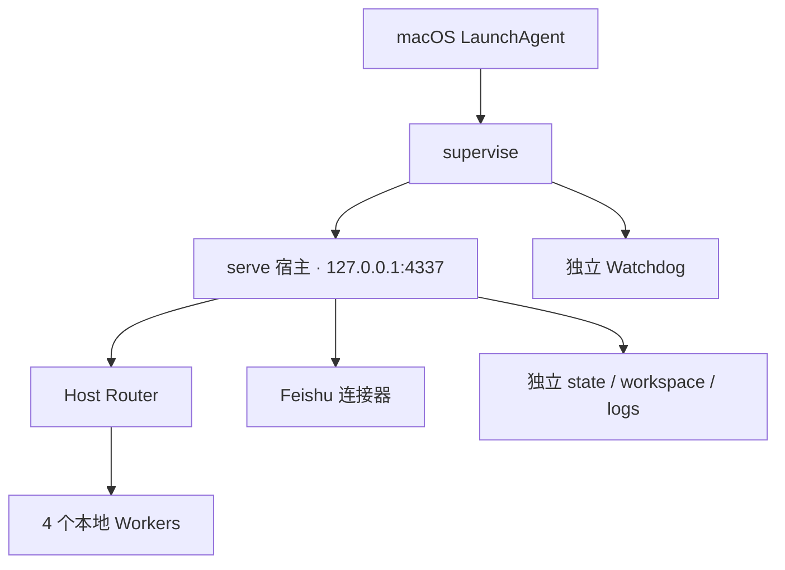

# 当前部署方案与运行现状

核对时间：2026-11-09 20:33:51（北京时间）。本次只读检查现有部署；没有升级、重启、配对或修改其配置。

## 正在使用的方案

当前是单机 macOS 常驻实例。LaunchAgent 启动 `supervise`，监督器分别管理宿主和独立 Watchdog；Feishu 入口由宿主运行的连接器接入。Router 和 4 个 Workers 属于同一实例。模型后端可以远程，工作文件和命令仍由本机宿主管理。

| 项目 | 实际观察 |
| --- | --- |
| 安装根目录 | `deployments/agenthub-feishu-router-20261106` |
| 代码 | `app` 软链指向 `releases/c9b6c6cc5c24` |
| 完整 release | `c9b6c6cc5c244449c1c144880bcecfdbb6eda3f2`，部署时间 2026-11-09 16:12:24 北京时间 |
| 服务 | `cn.local.agenthub.feishu-gdqs`，用户级 LaunchAgent，`RunAtLoad` / `KeepAlive` |
| 进程 | supervisor 8359，host 8376，独立 Watchdog 8377；宿主实际 cwd 属于上述 release |
| 健康 | `/health` 返回 `ok: true`、版本 `0.10.0`；监听本机 `127.0.0.1:4337` |
| 状态 | DB schema 7；设置 revision 11；Host Router、4 Workers、6 历史任务、0 活动执行、未全局暂停 |
| 本轮功能 | 未配置 delegation、0 teamTargets；本轮委派控制面尚未部署到该实例 |

LaunchAgent 的实际入口是 `/opt/homebrew/bin/node --import <app>/node_modules/tsx/dist/loader.mjs <app>/src/cli.ts supervise <root>/config.json`。它直接运行已构建 release；每次服务启动不会执行 `start.sh` 的网页构建步骤。plist 位于 `~/Library/LaunchAgents/cn.local.agenthub.feishu-gdqs.plist`。

代码、`config.json`、`state/`、`workspace/`、`logs/` 和升级证据目录分开保存。账号、浏览器、模型认证和任务账本留在私有状态中，不随代码软链切换。

## 程序支持哪些部署方式

| 方式 | 入口 / 实现 | 当前成熟度与边界 |
| --- | --- | --- |
| 本机个人安装 | `./start.sh` 或 `./start.sh setup <private-dir>` | 创建或复用个人安装；默认 `~/.agent-hub`；前台运行，不自动安装常驻服务 |
| 指定配置前台运行 | `./start.sh serve <config.json>` | 使用已有实例；独立终端负责生命周期 |
| 监督运行 | `./start.sh supervise <config.json>` | 宿主与独立 Watchdog；重启其拥有的子进程；还需 OS 服务管理监督器本身 |
| macOS 后台常驻 | LaunchAgent → supervise | 当前真实运行方案；用户会话级服务，不是系统级开机服务或 HA |
| Linux 主机 / VM | Node ≥22.19、Bubblewrap、systemd 模板 | 有 Linux CI / 特定 VM 的沙箱记录；systemd 是模板，未据此声称某台服务器已部署或验收 |
| 同机多个独立实例 | 各自配置、端口、stateDir、workspace、身份和凭据 | 本轮两真实进程已验证；可选择前台或各自服务托管；没有统一实例创建器 |
| 同机子团队委派 | A Router → B Router → B Workers | 收尾代码已实现一跳、显式配对与授权、目标独立验收；尚未切换现有实例 |
| Docker | `deployment/Dockerfile.linux-acceptance` | 验收镜像，默认执行 `npm run check`；不是正式运行镜像，没有已验收的生产 Compose |
| Windows | 部分程序入口存在 | 浏览器和命令沙箱的完整平台验收仍不完整 |

Linux 的已有记录有明确环境与日期，详见 [LINUX](LINUX.md)；不能外推为任意发行版、架构或容器策略均通过。裸 `setup` / `serve` 不启动独立观察器。单独的 `watch` 或 `watchdog` 观察进程也不自动取得重启另一宿主的权力。

外部 MCP 客户端当 Router、本地 `superagent_spawn` 子代理、不同模型 / 执行后端，属于接入或角色选择；它们本身不增加新的部署位置。多个进程共享一个可写 stateDir 不是多实例方案。

## 当前升级、回退和备份怎么做

当前真实部署采用“独立 release + `app` 原子软链切换 + 原配置和状态保留”。最近一次发布脚本与回读结果保存在私有工作树 `.local/plugin-history-fixes/`，实际发布证据在部署根目录的 `evidence/plugin-history-fixes-20261109-161217/`。这是一套经过该次发布验证的项目操作流程，尚不是仓库产品化的一键发布器。

最近一次流程实际包含：

1. 固定干净提交与发布目录，逐文件核对源码，安装依赖、构建、检查和确认对应 CI。
2. 检查活动任务、作业和未结投递；暂停新工作；停止整个 LaunchAgent 监督树并确认退出。
3. 备份停机状态与 WAL、配置、workspace，并形成可独立校验的 SQLite 副本；记录受保护文件和任务账本摘要。
4. 原子切换 `app`，重新启动 LaunchAgent；回读实际 PID / cwd、HTTP 和网页资产、设置、插件及保留账本，再恢复原暂停状态。
5. 出错可切回旧代码，但不直接倒灌旧数据库。新状态必须先证明旧程序兼容。

本轮启用普通委派会升到 schema 10，创建远端目标节点会升到 11；真实 `main 244dac0` Store 已验证拒绝两者。因而未来部署本轮功能后，不能仅切回当前 c9 或 Webhook-only 程序。应向前修复，或审查完整旧快照与外部效果后再离线恢复。Webhook v1 → v2 激活仍独立执行其备份和升级流程。

CLI `backup` / `verify-backup` / `restore` 负责数据库、受管配置等明确内容；开启委派后还包括身份校验与恢复隔离。它不包含完整账号、浏览器密钥 / 会话、全部工作文件、外部 CLI 认证及环境文件。完整安装恢复仍需停监督器并单独保存这些私有资料，恢复原实例后撤销旧配对再重新配对。具体操作见 [OPERATIONS](OPERATIONS.md) 与 [委派恢复](DELEGATION.md)。

## 本轮收敛后的选择

当前实际方案继续沿用 macOS LaunchAgent → supervise。需要分离同机团队的配置、账号或工作环境时，再创建第二个独立实例并开启 `managed-team`；单实例能满足工作时无须增加第二个 Router 的调用与运维成本。

已取消跨机器部署和 Worker 直接统筹远端 Workers；这不删除已有 Linux 单实例支持。本轮也没有新增正式镜像、Compose、系统级安装器、跨组织协作或 HA。当前源码集成和验证状态见 [收尾记录](DELEGATION_CLOSEOUT_2026-11-09.md)。
