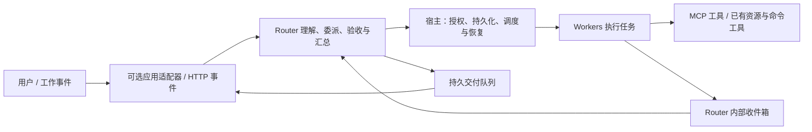

# 通用接入与应用适配器

AgentHub 的产品主体是 Router 管理的执行团队。接入软件提供事件、上下文和交付渠道；应用特有的会话语义仍由应用适配器负责。MCP 工具连接与消息入口独立，添加文档工具不会自动监听群聊或发送消息。



这沿用 DeepSeek 原型的 Source → Engine → 执行 / Outbox 边界，保留显式授权、原讨论续办和不确定结果核对。领域核心 `src/vendor/dsh-core` 未修改。Router 的组织管理定位是 AgentHub 的产品扩展，不能据此宣称与所有 DeepSeek 模型行为等价。

## 配置边界

| 配置 | 用途 | 生效方式 |
| --- | --- | --- |
| `sources` | 消息身份、监听范围、工作目录、回复渠道 | 原有准入设置可动态修改；部署字段需要停止并重启 |
| `sources[].capabilities` | 分别启用 `events`、`replies`、`resources` | 部署字段；省略时保持旧配置的三个开启默认值 |
| `sources[].options` | 自定义适配器的应用参数 | 插件验证；部署字段 |
| `sources[].observed` | 是否把未直接提及的事件交给既有准入规则评估 | 不改变准入身份；省略时沿用适配器默认值 |
| `sourcePlugins` | 明确加载的本地适配器模块 | 启动时加载；代码更新需要重启进程 |
| `toolConnections` | 出站 MCP 工具连接、传输与工具允许列表 | 启动配置；独立于 `sources` |
| `execution.workers[].toolConnections` | 授予某个 Worker 的工具连接名称 | 经既有 Settings / `worker_manage configure` 修改，下一次激活生效 |
| `backends` / `execution` | 模型、API / 订阅 / CLI，以及各 Agent 参数 | 沿用已有后端配置机制 |

工具连接默认不授予任何 Worker。子 Agent 不能获得超出父任务的连接权限。Router 通过管理工具委派执行；直接给 Router 设置 MCP 连接会被拒绝，避免保存实际不会执行的配置。`allowedTools` 使用确切名称，没有隐式通配符。工具标注的 `readOnlyHint` 不会代替这些授权。

关闭 `events` 后不会启动该来源的轮询或推送监听，也拒绝该来源的 HTTP 事件；`resources` 可独立保留。关闭 `replies` 时外部交付保持待发送状态，不冒充已送达；Router 内部收件箱仍可工作。单独关闭资源读取也会阻止旧资源别名及上下文接口读取。

当前控制台继续以任务和已配置接入为主，新应用位于“新建接入”。本轮没有为每个插件新增专用配置向导；自定义适配器和 MCP 服务器部署使用配置文件，`GET /integrations` 和配置快照提供实际注册清单。

## 最少代码接入：HTTP 事件

没有特殊平台语义时直接使用内置 `kind: "webhook"`，不必编写插件。例如添加一个来源：

```json
{
  "id": "work-events",
  "kind": "webhook",
  "cwd": "./workspace",
  "allowedActors": ["alice"],
  "listenScopes": ["engineering"],
  "tokenEnv": "WORK_EVENTS_TOKEN",
  "replyUrl": "https://your-adapter.example/agenthub/replies",
  "capabilities": {"events": true, "replies": true, "resources": false}
}
```

适配服务核实平台原始事件的发送者后，携带该来源的 `Bearer WORK_EVENTS_TOKEN` 值向 `POST /events/work-events` 提交：

```json
{
  "actor": "alice",
  "human": true,
  "event": {
    "id": "message-001",
    "thread": "topic-42",
    "text": "请检查这份方案",
    "addressed": true,
    "scope": "engineering",
    "at": "2026-11-06T09:00:00Z",
    "message": {"id": "platform-message-001", "url": "https://your-app.example/topic-42"},
    "attachments": [{"id": "file-123", "name": "proposal.pdf", "mimeType": "application/pdf"}]
  }
}
```

`at`、`scope`、`message`、`attachments` 可省略。附件信息是原始引用，不会自动下载或变成工具授权。接收地址上的来源 ID 决定身份命名空间；连接令牌不替代 `allowedActors`、`allowedBots` 和准入规则。管理令牌不能代替来源令牌。

重试同一事件必须保留 ID、身份及完整事件内容；修改身份、scope、原消息或附件引用会被拒绝。相同 ID 的重放在重启后仍去重。事件 ID 只在同一来源内唯一，不应把新消息当作旧消息重试。

回复固定 POST 到配置的 `replyUrl`，携带 `idempotency-key: <message.id>` 及同一来源令牌。正文包含 `id`、`kind`、`text`、`channel` 和可选 `ticketId`；`channel.address.messageId` 保留原始消息引用。回调服务应以消息 ID 去重并映射到平台原话题。HTTP 202 只表示事件已接收，不表示任务或外部发送完成。

发送断线、超时或返回无法确认的错误后，状态为 `uncertain`，不会自动重发。先核对目的端，再用已有交付核对流程处理。宿主仍绑定回环地址；跨机器入口需要部署者提供自己的代理或桥接服务，本轮没有开放公网监听。

## 应用特有行为：注册插件

配置 `sourcePlugins: [{"module": "./plugins/my-app.mjs"}]`。相对路径以配置文件目录为基准，模块默认导出 `SourcePlugin`：

```ts
export default {
  apiVersion: 1,
  kind: 'my-app',
  label: 'My application',
  validate(config) { /* 验证 config.options；失败时抛错 */ },
  create(config) { return new MyApplicationSource(config) }
}
```

插件是明确安装的可信本地代码，不是隔离运行的浏览器扩展。`create` 同步构造实现并保留原 `config` 引用；联网和监听放在 `poll` / `start` 中。重复 kind、未知 kind、版本不符和配置验证失败都会阻止启动，不会偷偷降级为另一个应用。

`Source` 必须提供 `trigger` 与 `deliver`；按需实现 `poll`、`start`、`close`、`validThread`、`members`、`identity`、`check`、`read`、`context`、`replay`、`references`、`initialBindings`。`start` 可异步，必须可重复调用；宿主会在轮询周期再次调用，以便适配器恢复断开的监听。`close` 必须停止监听并等待已接收事件落盘。推送型适配器不必提供空 `poll`。

插件通过 `SourceContext.receive / bind / closed` 进入宿主，不能替其他来源提交身份。规范见 [接口](../src/sources.ts) 和 [注册器](../src/source-plugins.ts)。`read` 配合 `source/<id>/<resource>` 或 `trigger-source/<trigger-id>/<resource>` 使用；`authorizeRead` 可进一步限制本应用内的资源范围。现有飞书、企微、GitHub 资源别名继续兼容。

[team-events 示例](../examples/plugins/team-events.ts) 增加租户话题校验；[完整配置](../examples/config.integrations.json) 只新增模块与配置即可启动，不修改 Runtime 的平台分支。它是通用事件桥接示例，不是假称已经接入某个真实 SaaS。

## 出站 MCP 工具

支持 MCP stdio 和 Streamable HTTP 的 `tools/list`、`tools/call`，包括工具分页、参数校验、文本 / 图像 / 结构化结果和 `isError`。示例配置中的地址、命令和工具名称必须替换为实际服务：

```json
{
  "toolConnections": {
    "documents": {
      "transport": {
        "kind": "http",
        "url": "https://your-mcp.example/mcp",
        "headerEnv": {"Authorization": "DOCUMENTS_AUTHORIZATION"}
      },
      "allowedTools": ["search_documents", "read_document"],
      "timeoutMs": 30000
    },
    "local-tools": {
      "transport": {
        "kind": "stdio",
        "command": "/path/to/mcp-server",
        "args": [],
        "cwd": "./workspace",
        "env": {"SERVICE_TOKEN": "LOCAL_TOOLS_TOKEN"}
      },
      "allowedTools": ["read_record"]
    }
  }
}
```

`headerEnv` 对应变量的值是完整头值，例如 `Bearer ...`；不会再次拼接 Bearer。`env` 将宿主环境变量映射为子进程变量，不在 JSON 中保存凭据值。stdio 不继承全部宿主环境，未显式映射的服务凭据不会自动可用。

为 Worker 设置 `toolConnections: ["documents"]` 后，它先调用 `superagent_tools` 获取实际工具 schema，再调用：

```json
{
  "connection": "documents",
  "tool": "read_document",
  "arguments": {"id": "document-123"},
  "requestId": "read-requirements-v1"
}
```

调用工具名为 `superagent_tool`。参数结构取自服务器；不把不同应用的业务参数压成一个通用字段集。JSON Schema 支持默认 2020-12 及显式 draft-07；不支持的声明会拒绝执行。

`requestId` 在同一个任务、同一个执行者内标识一次操作。并发重复、重启后重试均返回已有回执；换参数或连接配置会被拒绝。发送前保存执行记录，断线 / 超时 / 取消后的未知结果保持 `uncertain`。`tool-calls`、`tool-call/<id>` 资源及状态接口可核对回执。取消会通知远端，但不声称远端写入一定撤销。

当前是 MCP **工具**适配器：没有实现远端 resources/prompts、OAuth 登录向导或异步 task 执行。要求 task 执行的工具会明确拒绝；音频和其他内容保留为类型化 JSON，不声称模型已播放或理解它们。工具输出作为执行证据返回 Worker，不作为新的用户指令进入 Router。

## 升级、验证与回滚

已有 local / GitHub / 飞书 / 企微配置与准入状态继续读取。以前利用任意未知 `kind` 隐式走 HTTP 的自定义配置，需显式改为 `webhook` 或注册插件；这避免拼错应用名称后出现假接入。

改部署配置前停止任务并备份状态、启动配置、插件文件与凭据引用。修改 `sourcePlugins`、`toolConnections`、来源 options / capabilities 后，停止宿主和 supervisor，重新启动；不要向运行中的任务热换插件。标准状态备份不打包外部插件代码或外部环境变量。

本次不升级 SQLite 表结构。旧版本程序的严格配置解析器不认识新增字段，因此回滚需同时恢复旧程序、旧配置和升级前状态备份，不能只切换代码然后继续使用新版状态。待核对的外部操作不因恢复备份而变成“未执行”。

```sh
npm run typecheck
npx vitest run tests/source-plugins.spec.ts tests/tool-connections.spec.ts
npm test
```

自动化包含真实 CLI 进程加载插件、HTTP 事件 / 回调、真实 MCP 子进程及 Streamable HTTP 服务；模型角色由协议夹具驱动。它验证宿主行为，不替代飞书 / 企微真实账号验收，也不代表组织多租户、员工授权或跨组织资源隔离已经完成。
