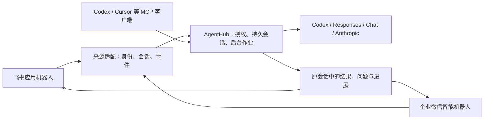

# 飞书、企业微信办公接入方案

推荐把通讯软件作为请求和回执入口，让同一个 AgentHub 后台处理任务。员工在私聊或群里用自然语言交代工作，继续补充、询问进展或要求停止；不要求填工单，也不绑定某个模型客户端。



通讯入口、任务来源和执行后端是三条独立的配置轴。接入企微不要求用腾讯模型；从飞书发出的任务也可以由任一受支持后端执行。客户端订阅不会自动提供 API 凭据。

## 推荐入口

| 软件 | 推荐方式 | 管理员/应用所有者一次性工作 | 日常使用 | 本轮状态 |
|---|---|---|---|---|
| 飞书 | 应用机器人 + 官方 CLI 长连接 | 机器人能力、消息权限、事件订阅、应用发布；加入指定群 | 群中 `@机器人` 或 `/agent`，在原话题跟进 | 已有真实收发历史；本轮 bot 身份验证、事件连接 ready 通过，未重跑新一轮真人收发 |
| 企业微信 | 智能机器人 → API 模式 → 长连接 | 开放创建权限，创建 Bot，提供 Bot ID/Secret | 私聊；允许的群内 `@机器人`，结果回到该会话 | 已实现适配并用官方 SDK 联测；当前企业明确拒绝创建，按用户选择保留真实验收待办 |

飞书长连接不需要公网回调地址，要求宿主能出站访问平台，见 [官方说明](https://open.feishu.cn/document/ukTMukTMukTM/uYDNxYjL2QTM24iN0EjN/event-subscription-configure-)。企微长连接方式和 Bot ID/Secret 配置见 [官方接入指南](https://intl.cloud.tencent.com/zh/document/product/1316/84454)、[企业微信团队 SDK](https://github.com/WecomTeam/aibot-node-sdk)。

群 Webhook 适合单向通知。需要“群里交代任务、继续对话”时，应选择以上机器人入口。飞书官方也区分 [应用机器人与自定义群机器人](https://open.feishu.cn/document/client-docs/bot-v3/bot-overview)；不要把一个 Webhook 地址配置成功当作双向接入验收。

## 本轮已落地的易用流程

1. 用 `office init` 生成独立工作区、端口、状态目录及本地私有凭据文件，不覆盖已有文件。
2. 应用所有者完成一次平台设置。凭据只进本机环境，不写进聊天、Git、MCP 客户端配置或模型提示词。
3. 启动后，用户先给机器人发送一条测试消息。
4. 操作员在控制台“来源”页核对观察到的用户 ID，再点击“允许此成员交代任务”。这是明确授予任务准入，不按显示名猜身份，也不把全群一次性自动加入允许列表。
   这是来源级人员允许列表；可使用的群和私聊范围由来源配置另行限定，不是只授权这条测试消息。
5. 用户重新发任务。之前被忽略的消息不会因授权而自动执行；后续跟进继续使用讨论上下文。

成员确认保存、刷新后的状态、旧消息不重放已验收。未配置凭据和未连接状态会如实显示，不能把“配置已保存”当作“机器人已上线”。目录不支持的来源不会显示成员同步按钮。

### 飞书配置

```sh
./start.sh office init feishu .local/office/feishu --chat TEST_CHAT_ID
```

生成配置默认使用已有 `lark-cli` bot profile，开启长连接，采用独立端口 4332；不需要为了 bot 接入重新登录个人用户。没有提供 chat ID 时，飞书来源保持停用，必须填好目标群再启用。群名解析可由应用所有者使用 `lark-cli im +chat-search --query 群名 --as bot`，只选择授权测试群。

在开发者后台开启机器人，订阅 `im.message.receive_v1`，选择长连接并发布应用。仅设置事件权限不一定足以运行当前完整适配：

- 收到群内 @ 的事件需要 `im:message.group_at_msg:readonly`；私聊需要 `im:message.p2p_msg:readonly`。
- 当前适配会读取原消息、轮询历史和补拉话题。官方对应用读取群消息要求相应消息读取权限及 `im:message.group_msg`，其中群全量消息属于敏感权限，需企业审核。
- 回复需要消息发送权限，例如 `im:message:send_as_bot`；目录、图片/附件分别按实际接口申请，不能把不相关的通讯录、邮箱或日历权限当作必需项。

依据：[接收事件](https://open.feishu.cn/document/server-docs/im-v1/message/events/receive)、[读取原消息](https://open.feishu.cn/document/server-docs/im-v1/message/get)、[回复消息](https://open.feishu.cn/document/server-docs/im-v1/message/reply)。如果企业只批准 @ 事件而不批准读取群消息，当前完整模式还不能直接使用；只依赖事件正文的轻量模式应另行实现并注明上下文/附件限制。

生成器返回启动命令。启动后在控制台确认发送者，群里使用 `/agent 请比较附件中的两版要求` 等自然请求。`mentionId` 需设为实际 bot ID 才能可靠识别仅 @ 的请求；初始化时也可先用 `/agent`。完整配置仍可调整允许列表、工作区、模型和其他来源。

### 企业微信配置

```sh
./start.sh office init wecom .local/office/wecom
```

生成器创建 `credentials.env`（0600）和 `config.json`，端口 4333。**当前账号实测没有创建权限，以下创建步骤需管理员开放后进行，尚未在真实企微完成。**

在企业微信工作台打开“智能机器人 → 创建机器人 → API 模式 → 使用长连接”，记录 Bot ID 和 Secret。若看到“当前无创建权限，请联系管理员”，由管理员开放创建入口或代建测试机器人；普通成员不能通过本地代码绕过。只给测试成员可用范围，之后再按团队需求扩展。

把两个值填进生成的本地文件，不要发到聊天：

```dotenv
AGENTHUB_WECOM_BOT_ID=
AGENTHUB_WECOM_BOT_SECRET=
```

按生成器返回的命令启动，形式为：

```sh
AGENTHUB_ENV_FILE=.local/office/wecom/credentials.env ./start.sh serve .local/office/wecom/config.json
```

`AGENTHUB_ENV_FILE` 指向的文件会从任务文件资源中排除，并在受管命令沙箱中单独屏蔽；符号链接使用真实目标。仍应把凭据放在工作区外，避免产生未登记的复制品或硬链接。

后台先建立出站 WSS、认证成功后才接收业务消息。首次只启用私聊，发送者默认仍无任务权限；在控制台逐人确认。群接入需配置 `wecom.chats`；只有明确选择 `otherChats=mentions` 才发现其他 @ 机器人的群，仍不改变人员允许列表。

适配基于官方 SDK 1.0.7，支持：

- 私聊及群会话、去重和持久输入、停止/跟进的原型路由。
- 接收回执与实际受理/完成分开。先持久化输入，再发送传输回执；回执不声称任务已获授权或完成。
- 文本、平台转写的语音文本、图片和文件/图文混排；每个附件最多 8 MB，及时缓存短期下载地址。文件名从平台响应保留，长中文文件名按字节安全落盘。
- 临时下载 URL、AES key 不进入模型可读消息记录；图片/文件使用锚定到当前请求的资源读取。
- 后台完成后主动向原会话发送结果。丢失发送回执保持 uncertain，不自动重复推送；会话移出配置后拒绝继续读和发送。
- 重启恢复已持久化的输入和已缓存附件；没有完成缓存的临时附件标明不可用，不盲目重放。

企微没有等价的飞书话题接口，当前用单聊/群聊作为讨论边界；不伪造原生子话题、引用消息 ID 或完整群历史。只保留实际收到的消息及文字引用；引用中的媒体、视频消息和完整历史拉取不在当前支持范围。并行工作遇到关联歧义时应澄清，不按主题相似度强行绑定。

主动推送受平台交互窗口及配额限制；适配在超过约 24 小时前主动拒绝发送，提示先让用户发一条新消息。官方指南对流式回复和异步推送窗口的说明见 [超时处理](https://intl.cloud.tencent.com/zh/document/product/1316/84454)。本轮没有用真实平台验证配额、窗口和机器人可见范围。

## 部署选择和边界

个人版可先用本机常驻进程，两款入口都无需为长连接暴露公网入站端口。电脑休眠、退出后台或网络断开会影响即时接收；“无需公网服务器”不等于“电脑离线也能工作”。

团队版推荐独立 Linux VM/普通账号、固定工作目录、服务监督和持久备份。见 [Linux 验收及限制](LINUX.md)。模型费用、机器人企业权限/配额、网络出站策略和文件缓存占用要分别管理；本轮没有完成长期负载与多租户验收。

SQLite 备份不包含 `wecom-media`、`assets` 里的附件或工作文件，应额外备份。缓存不会自动变成企业知识库；当前尚无自动附件保留期清理。

如果企业只开放自建应用，可规划“自建应用 + HTTPS 回调”的替代适配，但它需要 CorpID/AgentID、回调验签解密和公网入口，**本轮未实现**。不要把它和已实现的智能机器人长连接混称。

这次适配的是通讯入口与附件。飞书云文档编辑、日历、审批、企微业务应用操作并未因此自动获得能力。后续应通过有作用域与写入授权的业务工具接入，避免直接把整套企业凭据交给 worker。

## 其他常见通讯软件的扩展路线（尚未实现）

| 软件 | 官方接入方式 | 易用性取舍 |
|---|---|---|
| 钉钉 | 企业内部应用机器人 + Stream，见 [官方 Node SDK](https://github.com/open-dingtalk/dingtalk-stream-sdk-nodejs) | 与当前两款的长连接架构接近，可继续使用 Source；需应用创建及范围授权 |
| Slack | 应用 + Socket Mode + App/Bot token，见 [官方说明](https://docs.slack.dev/apis/events-api/using-socket-mode/) | 不要求事件 Request URL，适合工作区内部部署；应用安装与权限仍需管理员或所有者处理 |
| Teams | Teams 机器人/Agent 应用及消息服务端点，见 [官方创建说明](https://learn.microsoft.com/en-us/microsoftteams/platform/agents-in-teams/quickstart-create-agent-teams-sdk) | 先设计稳定的 HTTPS 服务部署，再补企业身份和会话映射；不假定能直接复用长连接配置 |

新增适配器需要复用消息身份、幂等、原会话回复、附件资源和不确定投递约束，另做真实平台收发与 UI 验收。优先接入团队已经在用的软件，避免为了机器人再迁移办公平台。
