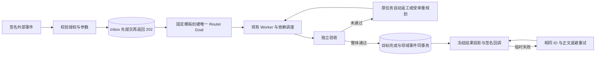

# Webhook：外部事件、长期推进与独立验收结果

P1 提供独立签名入口、持久收件、人工批准的自动化模板、现有 Router Goal 执行和独立验收、持久结果回调。普通 `/events/:sourceId` 与 `MessageSource.replyUrl` 保留原有协议；本功能不会改变它们对不确定外部副作用的处理。



## 启用

在启动配置添加 `"webhooks":{"port":4338}`，启动宿主。管理服务继续仅监听原端口的 loopback；签名入口另监听 `127.0.0.1:4338`，只接受 `POST /webhooks/<endpointId>`。`serve()` 返回 `webhookUrl`，用于端口设为 0 的隔离验收。

本阶段不自动配置公网地址、反向代理、TLS 或飞书入口。未来代理只能暴露这个独立 listener，不能代理管理端口。该配置是启动参数，不是热更新设置。

准备两个独立的环境变量，例如 `INTAKE_WEBHOOK_KEY`、`RESULT_WEBHOOK_KEY`，值格式为 `whsec_` 加 24–64 字节随机密钥的标准 Base64。配置与账本只存环境变量名。不要用管理 token 充当签名密钥。入站允许同时指定两个密钥引用；通过重叠保留旧/新引用进行轮换，轮换期间两个引用都必须可用。秘密值在受控启动环境更新，不写入任务文件。

仅本机验收允许显式配置 `loopbackCallbackOrigins:["http://127.0.0.1:9876"]`。例外必须匹配完整 origin，并且目标主机是字面量 `127.0.0.1` 或 `::1`；不会放开其他私网地址或 `localhost` DNS。生产回调默认要求 HTTPS，不允许 URL 凭据、查询串 token、重定向、私网或特殊地址。每次连接重新解析 DNS，检查全部返回地址，并固定实际连接地址，保留 TLS 主机名校验。

## 人工授权与模板

先在已绑定的群/共享入口，由当前 scope manager 明确提出长期自动化授权。通过已有聊天入口或管理端 `/send` 记录真实的人类输入，取得 `triggerId`。不能用一个机器事件声明 `human:true` 来创建授权。

管理端操作需要现有 operator token 或登录会话（仍执行同源检查）：

| 方法与路径 | 含义 |
| --- | --- |
| `POST /webhooks/grants` | 审批并创建不可变版本的事件绑定、参数规则、目标模板及回调投影 |
| `GET /webhooks` | 查看授权、收件状态、投递状态与尝试记录；不返回密钥值 |
| `POST /webhooks/control` | 停止/恢复收件、暂停/恢复回调、撤销授权、人工重投死信 |
| `POST /router-goals` | 使用现有 scope manager 权限查看、暂停、恢复、取消自动化目标 |

`POST /webhooks/grants` 请求示例（JavaScript 对象，序列化为 JSON）：

```js
const grant = {
  operationId: 'approve-intake-v1',
  triggerId: 'local:your-real-approval-message',
  authorizationQuote: '持续处理经过签名的审计事件', // 必须逐字来自这个人类输入
  namespace: 'intake-audit',
  eventSource: 'https://producer.example/intake',
  eventTypes: ['intake.audit'],
  secretEnvs: ['INTAKE_WEBHOOK_KEY'],
  parameters: { batch: { type: 'string', maxLength: 100 } },
  expiresAt: Date.now() + 24 * 60 * 60 * 1000,
  maxEvents: 100,
  maxConcurrent: 1,
  perMinute: 60,
  template: {
    title: '核对批次',
    objective: '核对指定批次并输出 result.json；不得部署。',
    criteria: [{
      id: 'verified', description: '结果通过核对',
      check: { kind: 'json_equals', path: 'result.json', pointer: '/verified', expected: true }
    }],
    nodes: [{
      id: 'audit', title: '核对', workerId: 'existing-worker',
      instruction: '根据 automationData.data.batch 核对已授权的本地数据，并生成 result.json。',
      criterionIds: ['verified']
    }],
    maxRepairs: 2, maxReplans: 2, maxTurns: 100
  },
  callback: {
    url: 'https://consumer.example/agenthub-results',
    secretEnv: 'RESULT_WEBHOOK_KEY',
    idempotent: true,
    events: ['goal.completed', 'goal.held', 'goal.needs_input', 'goal.cancelled'],
    resultFiles: ['result.json'],
    maxAttempts: 12
  }
};
```

模板审批必须认真选择验收标准：仅检查 `verified:true` 是接口示意，不足以证明复杂业务任务正确。实际模板应声明具体结果、证据文件和必要的独立语义验收。

授权保存真实审批人、来源引用及摘要、scope/entry、模板、期限、事件与并发预算、Worker/工具/网络配置快照。每次调度、工作工具调用和投递都复核当前授权。Worker、工具、网络或入口权限变化会阻止原授权继续使用，需要重新批准新的版本。P1 模板版本不可就地改写；新模板创建新授权。已接收事件不会被新版本重新解释。

事件只能填入明确声明的参数：字符串（长度上限，可选枚举）、数值（有限上下界）、布尔值；所有声明参数必填，额外字段拒收。不支持在目标、验收标准、权限、Worker ID 或回调地址中进行字符串模板替换。数据以 `automationData` 传给现有执行链，并标明不可信。机器身份与人类批准记录分开保存；机器输入不能写入激活的 Agent 记忆或改写原始要求。自主重规划只能使用原模板批准的 Worker/backend，并继续受原有合同和独立审查约束。

P1 使用现有 source 工作目录策略，不替每个事件自动创建业务目录。共享工作目录的模板应保持 `maxConcurrent:1`，并避免多个授权同时写同一批文件；需要隔离时使用既有 task workspace 策略和明确的模板路径。

## 外部入站协议

发送 CloudEvents 1.0 结构化 JSON（P1 子集）：

```json
{"specversion":"1.0","id":"batch-unique-id","source":"https://producer.example/intake","type":"intake.audit","data":{"batch":"2026-11-09"}}
```

必需 `specversion/id/source/type/data`；可选 `subject/time/datacontenttype`，`datacontenttype` 如提供必须是 `application/json`。`source` 必须是已批准的绝对 URI，`type`/可选 subjects 必须在批准范围。拒绝其他 envelope 字段；正文限 64,000 字节，不接受压缩请求。入口只返回收件凭证，不等待模型执行。

使用 Standard Webhooks HMAC-SHA256：

```text
webhook-id: transport_123
webhook-timestamp: 1790000000
webhook-signature: v1,<Base64 HMAC>

signed bytes = UTF8(webhook-id + "." + webhook-timestamp + ".") + exactRawBody
```

`webhook-id` 仅允许 1–200 个字母、数字、下划线、连字符；时间戳为秒，容差 300 秒。重复签名头会被拒绝。签名正文必须是 HTTP 实际发送的原始字节。密钥轮换可同时提供以空格分隔的 `v1,...` 签名。

- 首次有效请求：SQLite 提交 Inbox 后返回 `202 {receiptId,state,duplicate:false}`。
- 同业务事件重试：返回同一 receipt/goal，`duplicate:true`，不消耗第二次事件预算。
- 业务身份由可信 tenant、entry、provider account、namespace、CloudEvents source/id 组成；端点或 transport ID 变化不会生成第二个目标。
- 同身份不同规范化业务正文：409 `event_identity_conflict`。JSON 键顺序、空白和重新签名不影响去重；业务 time/subject/data 改变属于冲突。
- 无效签名 401；越权 403；schema 400；超限 413；预算/速率/待处理队列超限 429；存储不可用 503。429/503 携带 Retry-After。不会先返回 202 再依赖内存队列保存。
- 总待处理 Inbox 上限 1,000；grant 有独立速率、总事件和未结束目标并发限制。不同 grant 的等待队列不会相互饿死。

## 结果回调与故障恢复

所有自动化目标的状态变更在宿主 Store 事务中生成领域事件。`goal.completed` 还要求整体独立验收通过且证据仍有效，Worker 的 ready 声明不会直接产生完成回调。支持 started、waiting、needs_input、paused、held、completed、cancelled、verification_failed、replanned；只投递该授权显式订阅的类型。

回调 CloudEvent 包含 `data.schemaVersion:1`、goalId、receiptId、单目标递增 sequence、state、contractHash、模板版本、验收 round/criterion verdict，以及明确批准的结果投影。不发送原始事件参数、私有会话、Worker 断言、内部执行日志或 Agent 记忆。

`resultFiles` 只能选原始验收合同声明的文件。完成时从已验收快照取内容与 SHA-256；最多 10 个文件，每个最多 16,000 UTF-8 字节。过大的文件只发送路径、字节数、摘要与 `omitted` 原因；跨任务同路径但内容不同会标为 ambiguous，不猜选其中一个。此版本没有外部附件下载 API。

每个领域事件和订阅形成唯一 delivery。HTTP 头 `webhook-id` 是稳定 delivery ID，正文 `id` 是稳定 domain event ID。目标地址、正文和摘要在生成 delivery 时冻结；重试只刷新签名时间。接收端须以 delivery ID 持久去重，并在自己的业务提交后再返回 2xx。传输是有预算的 at-least-once，不能保证跨系统 exactly-once，也不保证抵达顺序；用 sequence 处理旧状态覆盖。

| 结果 | 处理 |
| --- | --- |
| 2xx | 标记 sent，仅表示接收端已接收 |
| 连接失败、丢失响应、408、429、5xx | 同 ID/正文重试；指数退避加抖动，基础上限 5 分钟，Retry-After 最多采纳 1 小时 |
| 401/403、缺失密钥 | held，等待管理员修复后显式 retry_delivery |
| 其他非 2xx、重定向、禁止的目标/DNS 地址 | dead，不自动重试 |
| 超过 maxAttempts | dead，保留全部尝试摘要 |
| 进程在 sending 中退出 | 新宿主恢复 pending，以同 ID 再投；不会重新执行 Goal |

管理 control 请求包含 `id`（授权 ID）、`operationId` 和 action：

- `stop_receiving/start_receiving`：只改变新收件，不撤销已接收工作的授权。
- `pause_delivery/resume_delivery`：暂停/恢复尚未发送的回调。被中断或已经 held 的投递须单独 retry_delivery。
- `revoke`：不可逆撤销自动化授权；阻止新事件和新执行，保留未完成目标为 held，终止执行能力并阻止待发回调。已被外部系统接收的副作用无法撤回。
- `retry_delivery`：额外提供 deliveryId，只允许 dead/held；复核原授权后增加一个投递尝试窗口。保留原目的地、ID、正文和目标执行结果。

授权过期或撤销后的目标不能通过普通 resume 复活；需要新的明确授权/目标。人工 pause/cancel 的状态在重启和重复事件后保留。回调暂停/死信与目标验收结果分别呈现，避免把“回调失败”误报为“任务失败”。

## 升级、数据与验收

首次创建授权在同一事务把数据库 user_version 提升为 8；旧版程序（最高支持 7）会拒绝打开，防止旧二进制忽略新的执行/投递语义。没有创建授权的现有库不会因此升版本。不要手工降低 user_version。回滚必须恢复完整的升级前一致性备份，并对升级后已经发生的外部事件/回调进行人工对账，不能仅替换二进制或复用旧 ID 盲重放。

P1 不自动删除收件去重记录或死信，避免晚到重试生成第二个目标；原事件参数和结果投影也会保留在宿主私有数据库。事件预算必须根据实际容量设置，后续需要接入带去重占位保留的归档/保留期策略。此版本不声称能发现上游从未发送的事件，平台 cursor/API 对账属于后续阶段。

自动回归：`npx vitest run tests/webhooks.spec.ts`。真实模型与 HTTP 验收：

```sh
WEBHOOK_ACCEPTANCE_DIR=/absolute/fresh/evidence-dir node --import tsx examples/webhook-acceptance.ts
```

该脚本隔离 state/workspace，启动真实 Router、Worker 和独立 verifier，执行 30 行/18 唯一记录的三阶段任务；显式注入一次错误产物和假 ready 报告。四个宿主进程间进行三次真实 SIGKILL：收件落盘后、错误验收后、接收端已提交但尚未回应时。接收端下一次返回 503，随后 204。结果证据验证一次业务效果、同 ID 三次投递、原合同保持、原任务返工、回调不重跑任务，以及只有获准文件出现在结果中。失败注入是受控测试条件，不冒称自然发生的模型错误。

实现参考 [Standard Webhooks](https://github.com/standard-webhooks/standard-webhooks/blob/main/spec/standard-webhooks.md)、[CloudEvents 1.0.2](https://github.com/cloudevents/spec/blob/v1.0.2/cloudevents/spec.md)、[Node BlockList](https://nodejs.org/api/net.html#class-netblocklist) 和 IANA [IPv4](https://www.iana.org/assignments/iana-ipv4-special-registry)/[IPv6](https://www.iana.org/assignments/iana-ipv6-special-registry) 特殊地址注册表。没有复制其他 Agent 项目的任务引擎。

## P2：事件续接与恢复

新授权可设置 `protocolVersion:2` 和 `continuations`。每条规则固定节点、事件类型、关联参数、等待上限及早到事件保留时间：

```json
{
  "protocolVersion": 2,
  "continuations": [{
    "id": "release",
    "nodeId": "build",
    "eventType": "ci.release",
    "correlationParameter": "batch",
    "timeoutSeconds": 1800,
    "earlyEventSeconds": 86400
  }]
}
```

`correlationParameter` 必须引用已声明的字符串参数。启动类型和续接类型不能重叠，同一个规则在一个目标中只订阅一次。关联值在授权生命周期内不能被另一个启动事件复用，即使旧目标已经完成。续接事件使用同样的参数 schema；它没有权限提供 goalId、taskId、assignment 或扩大任务。

Worker 使用：

```json
{"action":"wait","ruleId":"release","requestId":"release-wait"}
```

工具名为 `superagent_event`，仅向获准使用它的根 Worker 开放。调用立即返回持久等待；Worker 应报告 `waiting` 且不提出人工问题。`read`/重用同一 `wait` 请求读取原订阅，`cancel` 只取消自己的订阅。宿主把消费收件、写入任务输入、标记等待已交付放在同一事务内。目标原始 contract、节点方案、scope/owner epoch 和 assignment 都参与检查。订阅失效后不能自动转交新 assignment。

早到事件先保存在 Inbox，不会抢占启动事件。事件在等待截止前已入库，即使重启恢复时已过截止，也仍可正常消费。没有匹配目标的事件按 `earlyEventSeconds` 过期。截止后才到的事件、已完成/取消目标的新事件和已消费事件的重复投递不会重新启动目标。暂停保留等待和已接收事件；只有有效的人为恢复才能继续。撤权会使等待失效。等待超时写入明确的缺失证据通知，不伪造输入；缺少固定事件证据的 `ready` 不能进入完成流程。

已经消费的事件是保留证据。原任务的自动返工、经独立审查的重规划可更新数据版本和执行方案，继续使用这份证据；归属、授权、原始 contract 和 assignment 仍须有效。等待中的订阅检查完整数据版本及其自身节点方案，不因其他节点重规划的全局版本递增而失效。目标完成时逐项核对原授权的所有事件规则及相互关联的消费账本，不能通过改变计划遗漏外部前置条件。

错误恢复区分以下情况：

| 情况 | 恢复方式 |
| --- | --- |
| 回调 408/429/5xx/网络中断 | 原 ID、正文与目标自动退避重试；遵守预算和 Retry-After |
| 回调 401/403/密钥不可用 | held，修复凭据后人工重试原回调 |
| 其他不可重试 HTTP / SSRF / 重试耗尽 | dead，不重做业务任务 |
| 目标创建事务失败 | 收件 held；`/webhooks/replay` 可在原授权仍有效时重试未派发的原事件 |
| 撤权、关联冲突、归属变化 | held/stale，不通过重放恢复权限 |
| 等待超时或无目标的早到事件过期 | expired；保留账本，需检查上游与授权，不补造事件 |

`POST /webhooks/replay` 使用 `{receiptId,operationId}`，只允许尚未绑定目标/等待的 `dispatch_failed`。完成、取消、消费过的事件不能重开。`POST /webhooks/reconcile` 以及宿主定期对账只从已有领域事件恢复缺失投递，沿用事件 ID、正文、目标和尝试账本。不会根据 Worker 自称成功生成完成事件。已成功的尝试不会重发，已 held/dead 的尝试不会绕过分类。

独立 Watchdog 的目标快照包含 `waiting:external_event`、截止时间和等待元数据；合法等待不作为停滞恢复。快照另提供收件 held、待投递、超时等待数量和最近对账时间。恢复和补偿的最终执行仍由宿主在当前授权下完成。

## P3：工作台、平台与协议运维

登录本机工作区后，导航中的“事件自动化”打开 `/webhook-workbench`。可创建授权、查看固定规则、预演规范化事件、筛选自动化、检查目标节点、暂停/恢复/取消目标、查看收件/回调历史、重试原事件或原回调、对账和轮换密钥。预演不写入收件、不创建目标、不发送 HTTP 回调。事件内容只在受现有 operator 账户权限保护的详情接口显示；公网独立端口没有任何管理 API。

控制台新增接口均在现有 operator 认证及同源写入检查之后：

- `GET /webhooks/detail?id=...`：有界事件详情及目标、领域事件。
- `POST /webhooks/dry-run`：`{id,event}`，校验**规范化后的** CloudEvent 与规则。返回 `effects:none`；不模拟上游网络或签名。
- `POST /webhooks/goal`：`{id,action:pause|resume|cancel,operationId,expectedRevision}`，复用原 Router Goal 权限与版本检查。
- `POST /webhooks/rotate`：`{id,operationId,expectedRevision,inbound,outbound,overlapSeconds}`，仅接收环境变量名。
- `POST /webhooks/replay`、`POST /webhooks/reconcile`：上述有界恢复操作。

密钥轮换采用版本比较与持久命令去重；输入最多保留一把前任密钥，重叠最长 24 小时。重叠期间不能再次更换输入密钥而提前丢弃旧承诺。输入与输出密钥必须分离。接收方须先准备接受新输出密钥，已接受回调保留 ID、正文和目的地；轮换后的新尝试使用新输出密钥，正在发送的旧尝试不能撤回。尝试签名引用会记入宿主私有账本。不要在重叠期删除旧输入环境变量；不要把秘密值粘贴到工作台。

### GitHub Actions 首个适配器

设置 `transport:{kind:'github-workflow',repositoryId:123,repository:'owner/repo'}`，`eventSource` 必须是 `https://github.com/owner/repo`。仅支持 `workflow_run` 的 `requested`、`in_progress`、`completed`，例如固定启动类型 `github.workflow_run.completed.failure`。参数为 `repository`、`runId`、`attempt`、`sha`、`conclusion`、`status`，按模板声明类型/范围。

GitHub 中的 Secret 填输入环境变量的**完整字符串值**，HMAC 使用其原样 UTF-8 字节；标准 Webhook 仍使用 `whsec_` 后 Base64 解码后的密钥。宿主校验原始 body 的 `X-Hub-Signature-256`，并固定仓库 ID、仓库名和授权时间下界。业务 ID 从已签名的仓库、run、attempt、action、status、conclusion 生成，未签名的 `X-GitHub-Delivery`/`X-GitHub-Event` 头不能改变业务身份。原始正文重序列化后签名不再有效。GitHub `ping` 不创建任务。

签名与重投递语义依据 [GitHub 验证文档](https://docs.github.com/en/webhooks/using-webhooks/validating-webhook-deliveries)、[重投递与去重建议](https://docs.github.com/en/webhooks/using-webhooks/best-practices-for-using-webhooks)。GitHub 不保证自动补发失败投递，见 [官方重投递说明](https://docs.github.com/en/webhooks/testing-and-troubleshooting-webhooks/redelivering-webhooks)。平台从未发送的事件仍需上游 cursor/API 对账；本实现不推断未收到事件已经发生。

### 插件 Webhook capability

Source Plugin API v2 manifest 可声明 `methods:['webhook']`（可额外声明 `close`），设置 `network:false`、空 `credentials`，并提供 `webhook({schemaVersion:1,event})` 返回规范化后的 `data` 对象。授权的 `normalizerSourceId` 固定选择该来源，来源必须在原 scope 中。执行使用现有独立 sandbox 进程；宿主不发送签名密钥、历史快照或跨来源权限。normalizer 不能读取宿主 records、写状态、注入 Trigger，也不能同时持有聊天/工具/网络能力。

插件只能投影数据；CloudEvent 的 id/source/type 与授权规则由宿主保留并复核。原始规范化前事件参与冲突指纹，两个不同原文即使映射成相同参数也不会变成相同请求。插件包与配置变化使原授权的权限快照失效，需要重新批准。插件不能决定新目标、验收或回复地址。

### 协议激活与回滚

CloudEvents envelope 保持 1.0，回调 `data.schemaVersion` 保持 1；`protocolVersion:2` 指新增授权/等待/轮换语义，SQLite 屏障为 schema 9。全新无授权数据库可在首次创建 v2 授权的同一事务中启用。已有 P1 数据必须先停止宿主，再运行：

```sh
npm start -- webhooks upgrade /absolute/config.json /absolute/new-backup-directory
```

升级获取与宿主相同的独占锁，创建并验证完整备份，再事务激活 schema 9；备份失败不激活。活跃宿主或残留未核实锁会拒绝升级。旧 P1 二进制拒绝打开 schema 9；恢复旧备份不能抹掉等待、撤权、收件 ACK 或回调尝试。不要通过回滚旧二进制重放已有副作用；保留新协议并做向前修复。

### 容量、网络和部署边界

Inbox 全局最多保留 1000 条尚待处理事件，单次原始请求最多 64 KB，超额返回 429/413 且不 ACK。已接受事件、关联占位和死信不自动删除。工作台列表最多展示最近 1000 条，单入口详情最多 200 条；完整记录在私有 SQLite 中。历史归档、长期保留期和更大规模分区属于后续运维工作，不能直接删除去重占位。

独立监听器只绑定 loopback。公网可在它前面使用受控 HTTPS 反向代理/隧道，管理端口保持私有。本次临时 Cloudflare 隧道用于合成数据实测，TLS 在 Cloudflare 终止，不是生产保密保证。当前没有离线云端存储中继：宿主离线时公网应返回失败，由上游重投；本机已 ACK 的 Inbox 则可重启恢复。不要把临时隧道当成生产 SLA 或无限离线容量。

P2/P3 的本次实现、故障注入、真实模型与公网平台验证结果见 [验收与自查记录](WEBHOOK_P2_P3_REVIEW_2026-11-09.md)。
