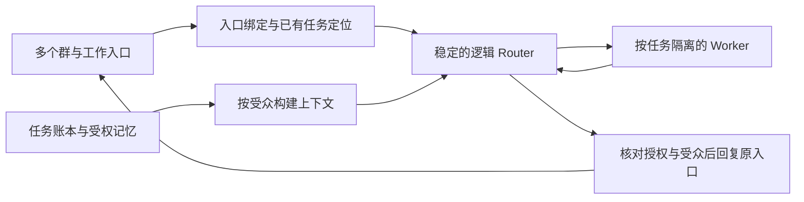

# 第一步设计：跨群 Router 归属与可追溯记忆

版本：设计 v1，2026-11-06（Asia/Shanghai）。状态：待实现的规范；不是上线说明或验收通过记录。

配套：[验收规格](ROUTER_SCOPE_MEMORY_ACCEPTANCE_2026-11-06.md) · [迁移与回退](ROUTER_SCOPE_MEMORY_MIGRATION_2026-11-06.md) · [记忆组件调研](MEMORY_BACKEND_RESEARCH_2026-11-06.md)。

## 1. 目标、范围与已知现状

用户面对一个持续负责团队/项目的 Router；同一管理范围可以包含多个群。换话题、换入口或服务重启后，已获准任务及相关决策仍可定位。Worker 保留独立模型、参数、技能和按任务隔离的执行上下文，结果经 Router 对外表达。

本期交付稳定管理归属、任务与入口关系、结构化记忆及共享/撤回、上下文重建、旧任务迁移。下一期才实施主动判断批处理、订阅直达优化、业务提醒、任务依赖编排和发言频控。本期不改变 off/observe/auto 的含义，不以记忆更新启动执行。

设计核对的工作树：`work/agenthub-parity-fixes-20261106`，基础提交 `eb0dabb4e0f65f48b175189df46b65319cf01421`，包含此前未提交修改。本轮只新增设计文档，不覆盖这些修改。

| 当前事实 | 依据 | 本期改变 |
| --- | --- | --- |
| host Router discussion 是 source + thread | [router-ingress.ts](../../src/router-ingress.ts) | 引入稳定管理归属；原 discussion 保留为会话入口/旧记录别名 |
| Worker 委派通过 discussion 限制管理访问 | [worker-manager.ts](../../src/worker-manager.ts) | 改为任务 owner + 入口许可 + 当前授权联合判断，不能仅移除原检查 |
| Router、任务、作业、出箱已在 SQLite 持久化 | [store.ts](../../src/store.ts)、[runtime.ts](../../src/runtime.ts) | 在同一事务边界增加归属/事实/撤回记录 |
| API 保存协议历史，达到大小限制时报错 | [api.ts](../../src/backends/api.ts) | 加入带来源清单的上下文重建；不伪称自动无限记忆 |
| Codex 线程状态属于原生后端 | [codex.ts](../../src/codex.ts) | 逻辑 Router 身份与原生线程解耦；旧执行线程按迁移规则保留 |
| vendor 的 memory.ts 是测试用内存仓库 | [memory.ts](../../src/vendor/dsh-core/memory.ts) | 不把它列为已实现的长期记忆 |

用户已选择未来让群内所有成员提出任务。该偏好与“所有群自动共享历史”“所有成员可修改权限”无关；部署时仍须形成明确的成员准入规则。迁移不自动扩大现有允许名单。

## 2. 必须满足的约束

| 编号 | 规范 |
| --- | --- |
| D01 | tenant 是最高隔离边界；来源身份使用原生 ID 与账号命名空间，不按姓名、群名或语言模型推断合并 |
| D02 | 一个入口同一生效区间只有一个默认管理范围；每个任务只有一个当前 Router owner；共享上下文不产生共同所有权 |
| D03 | Ticket/Assignment 仍是执行状态真源；Router 会话、摘要和记忆引擎不能自行宣布任务完成或重开 |
| D04 | 阅读、共享、发起任务、修改现有任务、管理 Worker、修改规则是不同能力；记住内容不增加任何能力 |
| D05 | 管理范围一致不等于模型上下文可混用；每次调用须满足当前读取范围和拟回复受众，原生历史同样受约束 |
| D06 | 每条可用事实有来源/版本/有效性；模型推测不得无标记升级为事实；摘要不能取代证据 |
| D07 | 检索前筛范围，召回后核验，工具使用和实际发送前再核验；列表、计数、标题、引用也不能越界 |
| D08 | 撤回/清空推进代次并封锁迟到写入；失效传播到摘要、索引、上下文及未发送结果；失败不能显示彻底完成 |
| D09 | 状态变更、事件消费位置与效果入队一致提交；冲突可解释；超时不视为没执行；外部不确定效果不盲目重放 |
| D10 | 迁移保留任务、授权、Worker 线程、执行目录、回执与幂等关系；缺依据的记录隔离处理，不自动猜测修复 |
| D11 | 本期只增加宿主能力，不改 DeepSeek vendor 核心；现有来源、主动模式、模型、规则和实际部署不因设计文档变化 |
| D12 | MemoryProvider 可替换；缺能力、读不全、超预算、历史不可取均明确返回，不扩大范围或声称已验证 |

DeepSeek 的事件、授权、任务、委派及“上下文不扩权”原则继续成立。管理范围、共享许可和记忆控制面是 AgentHub 的产品扩展；不把个人/组织实体加入原型领域核心。[官方领域模型](https://github.com/deepseek-ai/dsh-superagent-prototype/blob/main/docs/001-domain.md)、[官方授权模型](https://github.com/deepseek-ai/dsh-superagent-prototype/blob/main/docs/002-authorization.md)。

## 3. 跨群 Router 归属

### 3.1 对象与生命周期

以下名称是拟定内部契约，不代表接口已经存在。界面使用团队名、群名、任务名，不要求用户输入内部 ID。

| 对象 | 必需信息 | 唯一写入者 / 作用 |
| --- | --- | --- |
| 管理范围 ManagementScope | tenantId、scopeId、名称、负责人角色、状态、revision | 管理配置服务；一个团队/项目的职责边界 |
| Router 身份 | routerId、scopeId、后端配置引用、运行代次 | 管理配置服务；一个 scope 一个逻辑 Router，可有多个隔离会话 |
| 入口绑定 | bindingId、规范入口键、scopeId、生效区间、revision、成员准入策略引用 | 绑定服务；群/项目入口怎样进入默认 Router |
| 来源主体 | provider、accountNamespace、nativeActorId；可选已验证关联 | 连接器确认身份；跨来源关联只能来自受控配置，不转移原有授权 |
| 任务归属 TaskOwnership | ticketId、scopeId、routerId、ownerEpoch、授权锚点 | 归属服务；唯一 owner，执行状态仍属于 Engine |
| 任务入口 TaskChannel | ticketId、channelRef、origin/context/request/result 用途、许可引用 | 归属服务；明确在哪能看、补充、请求变更、接收结果 |
| 会话映射 | tenantId、routerId、audiencePartition、contextEpoch、backendIdentity、nativeThreadId | 会话服务；不作为任务或授权的唯一依据 |
| 旧标识别名 | oldSource/oldDiscussion/oldOperationKey → 新归属及原始 ID | 迁移服务；可审计、不覆盖历史、不用于扩大范围 |

规范入口键由 tenant + provider + 已验证连接账号命名空间 + 平台原生群/容器 ID 组成。连接器重命名不会创建新入口。同一物理入口的多个配置别名须有已验证映射；不同机器人账号下无法证明等价的群 ID 不按名称合并。

本期不支持一个群按自然语言主题自动选多个默认 Router。一个群多个项目确有需要时，先使用明确任务引用和既有任务入口；未绑定的新任务需先明确归属。未知入口不会自动成为管理范围。

### 3.2 新事件的确定性定位顺序

1. 校验来源、事件身份、监听范围和准入；拒绝事件不因此进入长期事实。
2. 先查事件幂等记录、旧标识别名；重放保持原处理归属。
3. 若为明确任务引用，核验该任务在当前入口的 request/context 能力，使用该任务 owner；知道任务 ID 不等于获准访问。
4. 若为原话题后续消息，查已登记任务关系；一个话题可有多个任务，不按主题相近任意选一个。归属不明确时仅澄清，不新建重复工作。
5. 没有任务归属时，使用事件被系统首次接纳时有效的入口绑定。以平台创建时间补发的旧消息，也不能倒推获得已经撤回的权限。
6. 无绑定或绑定冲突时记录 blocked/unassigned，不猜测 Router，也不启动 Worker。

同一管理范围中的群 A、群 B 可以交给同一个 Router。一个任务从 A 开始，在 B 用明确引用继续，需先具备对应 TaskChannel 许可；满足后继续同一个 ticket 和原 Worker，不能复制成新任务。同一项目、同一请求者只提供候选关联，不自动建立共享。

### 3.3 群改绑、任务转交与成员变化

| 操作 | 确定行为 |
| --- | --- |
| 群改绑给 Router B | 生效后新工作归 B；已有任务仍归 A；旧话题由入口网关转回其 owner，且必须继续满足当前监听/访问许可 |
| 整群及其旧任务一起搬迁 | 展开为群改绑计划 + 逐任务转交清单；没有隐式批量所有权变化 |
| 同 tenant 内转交任务 | 两端有管理权限的操作员提交版本化计划；无在途执行/不确定效果后原子变更 ownerEpoch，保留 ticket、mandate、Worker 线程、目录、历史和旧入口许可；禁止两端同时调度 |
| 拆分/合并管理范围 | 本期以入口改绑和逐任务转交组合完成；不自动合并事实库或模型历史 |
| 跨 tenant 转交 | 本期拒绝直接迁移；如有需求，只能授权导出有限成果，并在目标 tenant 重新受理新工作 |
| 群成员退出/新加入 | 更新当前访问关系及 contextEpoch；历史可见性依平台/团队明确规则，不推断所有旧内容对新人可见 |
| 机器人退出群/连接撤销 | 冻结该入口的交付与新上下文读取；任务不因丢失入口自动删除，也不能借另一群继续暴露原群内容 |

scope 管理者可以管理团队共享记录；不能因此读取个人私有内容。身份映射变更只影响之后可证明的访问，不能重写旧消息发送者。群成员拥有请求能力并不意味着可以取消他人的任务；现有任务变更按请求者/指定负责人/管理员能力核验。

任务转交还要求目标 Router 已具备任务所需材料的读取许可、执行环境权限和适用后端能力；仅拥有两个项目的管理角色不够。条件不足时保留原 owner 或 held，先形成具体的资料/执行授权，不能靠转交反向制造访问权。

## 4. 记忆共享边界

### 4.1 两个维度必须分开

记忆所属管理范围用于归档；记忆可见范围用于读取/发布。绑定同一 Router 只改变前者。

| 可见范围 | 默认可用场景 | 不自动发生的行为 |
| --- | --- | --- |
| 个人 private | 本人获准的私人入口及明确绑定的执行任务 | 同一个人在群里说话不会让私有记忆进入群回答 |
| 群 group | 原群允许的历史范围，及为该群执行的任务 | 不因 Router 同属一个项目就进入另一群 |
| 项目 project | 有明确成员规则及知识共享声明的项目入口 | 群加入项目不会自动导入历史消息或个人记忆 |
| 组织 organization | 经授权发布的共同规范/知识 | 不把组织所有聊天视作公共资料 |
| 任务 task | 此任务所获准材料、执行者和明确结果入口 | 不随同一 Worker 的下一个任务传播 |

私有数据由本人或预先指定的受托主体决定分享；群来源的可共享类别由该群的资料管理规则决定，默认由获准管理者发布。普通成员可以提议共享，不能替别人的私有资料授权。

把群 A 的决定分享给 B，应建立一个独立的发布记录：所选事实版本、允许目的、目标入口/受众、授权人、有效期、是否跟随新版本。默认是固定版本，修改事实不会静默覆盖已分享版本；原事实纠错或撤回会把该发布记录标记需复核并停止继续注入。新增群只得到此后明确发布或符合既有共享声明的内容。

派生摘要、向量、实体图和模型输出继承全部输入的范围约束。混用多份材料时，能够发布的受众是它们的交集。若同一事实存在独立且可公开的来源，可以从这些来源单独构建新投影；不能在混合摘要上简单去掉受限引用后扩大权限。

### 4.2 读取与回复协议

每次读取由宿主生成上下文：tenant、逻辑 Router、当前入口、真实请求者、任务授权、拟回复受众、ACL/记忆代次。模型只能提供查询意图和已见对象引用，不能自行选择 tenant 或用管理员身份扩大范围。

查询顺序：范围检查 → 精确任务/事实引用 → 受权全文检索 → 可选外部检索 → 当前版本/来源/有效性复核 → 有预算的上下文包。返回明确的 complete/truncated/unavailable，分页游标绑定范围与版本；权限变化后旧游标失效。

不能只在最终文字中删去私有内容：限制必须发生在模型读取之前。普通群回复只使用可向整个该群发布的上下文。需要受限材料继续执行时，用任务隔离会话；其结果也受该材料范围约束，发布必须具备独立、明确的许可。当前入口无权看到任务时，不返回任务标题、数量、负责人或命中片段。

连接器不能证明必要的成员/历史可见性时，该能力标为 unknown；不自动继承历史或跨群共享。此时仍可使用当前获准消息与明确面向该入口发布的资料处理请求，不把 unknown 当作全群历史可读。

### 4.3 会话与缓存隔离

逻辑 Router 连续，物理 Session 可轮换。仅在 tenant、router、受众分区、上下文代次和后端身份兼容时续用原生 Session。不能靠追加一句“忘掉上文”清除旧会话中的受限材料。

撤回、删改关键来源、成员可见性收窄或跨范围转交时：递增相关 contextEpoch；停止旧会话的新工具与发送；把在途结果标为待核对；在完整协议边界以当前获准材料构建新会话。已经执行的操作保留事实，不自动重做。原生后端不支持可靠清理时，旧线程禁止自动恢复，并如实保留删除状态。

Worker 在正常同范围迁移时保留原线程；如果其历史已包含不再获准的材料，则冻结后按同一逻辑任务建立受控接续，而不是复用污染历史。接续保留工作目录、已发生效果及任务身份；必须记录替换原因、旧线程指针和核对结果。

## 5. 记忆记录与更新协议

### 5.1 记录结构

每条事实至少包含：memoryId、revision、tenant/scope、kind、subjectKey、内容、状态、来源引用列表、来源关系（独立支持或联合依赖）、有效时间、写入时间、作者/抽取器版本、共享许可引用、supersedes、generation。

来源引用包括平台原文 ID/版本或不可变工作结果 ID、证据位置、内容指纹及当时可见范围。未知事件发生时间不能用抓取时间冒充。来源暂时不可访问可用受权快照支持并标记新鲜度；未取得原文的说法不能升级为已核实事实。

| 层 | 作用 | 约束 |
| --- | --- | --- |
| 事件/证据 | 原始消息、工具回执、交付事实 | 信封不可变；正文可经删除流程清除，保留最小必要回执，不以不可变为由阻止删除 |
| 工作状态 | Ticket、Assignment、进度与问题 | Engine/相应宿主组件唯一写入；摘要中的完成说法不改状态 |
| 事实与决策 | 团队决定、背景、确认过的约束 | 版本化、来源化、可纠正 |
| 工作摘要 | 管理范围摘要、任务摘要、检查点 | 可重建，含源事件水位和依赖版本；不能成为新授权 |
| 团队规则/技能 | 明确维护的规范与经验 | 配置版本独立；记忆抽取只能提出修改建议，不能静默生效 |

### 5.2 状态与冲突

| 状态 | 含义与可用性 |
| --- | --- |
| candidate | 抽取建议或不确定推断；可进入待确认视图，不能作为已确认事实注入 |
| active | 有依据且满足采纳规则；可按权限检索 |
| disputed | 同一主张存在未解决冲突；只可呈现带依据的分歧，不任选其一 |
| superseded | 已被确定的新版本替代；普通检索排除，授权历史查询可看 |
| expired | 已超过适用时间；不用于当前决定 |
| revoked | 依据或共享被撤回；不再参与召回或输出 |
| tombstoned | 删除指令已生效；内容清理可仍在进行，禁止使用和重建 |

系统回执等确定记录可以直接进入工作状态；明确要求记住的、本人有权声明的事实可原子采纳。自动语义抽取默认 candidate，可通过预先配置的具体采纳规则处理明确团队决定，不能把“一切看起来确定”作为规则。第一步默认不自动抽取个人画像，也不批量回灌旧聊天。

事实更新带 expectedRevision 与稳定 operationId。同一事件重试只有一个结果；相同 operationId 不同内容被拒绝。并发两次更新不得后写覆盖前写；冲突保留候选及证据。相同主题不代表同一事实键，不以相似度自动合并。

一条事实有两个独立证据，删除其中一个时，只撤销相应支持；剩余证据仍足够则重建其可用投影。联合依赖失去一项，必须失效。事实修订、来源撤回与摘要失效在一个本地事务中记录，后续索引同步通过持久作业完成。

### 5.3 遗忘、删除与恢复

| 用户意图 | 系统语义 |
| --- | --- |
| 暂时不用记忆 | 禁止注入/自动抽取；数据仍存在，不能显示为删除 |
| 忘记一条事实 | tombstone + 抽取抑制记录；旧消息再被读取也不自动恢复该事实 |
| 清空某范围记忆 | generation 递增，建立历史处理水位；旧抽取/摘要/导入任务提交失败；新消息可按当前设置产生新记忆 |
| 删除来源正文 | 清理受管正文、索引、附件及受影响派生物；不等同于撤回飞书已经发送的消息 |
| 从备份恢复 | 先重放备份之后的撤回/删除账本，再开放读取、原生线程和索引；账本缺失则仅离线恢复 |

提取任务必须在读输入前捕获 generation、源版本和 ACL 版本；提交时比较，不能在模型返回后重新取得新代次绕过检查。每个范围记录已处理、待处理、失败区间；重试失败有可见缺口，不能推进水位后声称完整。

正文删除覆盖本地事实/摘要、全文索引、外部投影、可控文件和会话缓存。外部平台消息及模型服务端留存不在本地物理删除保证内；管理页分别呈现“停止使用”“本地清理完成”“外部清理待验证”。备份按保留周期清理，在此之前恢复屏障持续阻止内容重新使用。

一期默认不自动删除已有证据，也不自动导入历史；事实如有明确 expiresAt 按时失效。部署可设原文/索引/备份的保留期，界面显示存量与清理状态。没有配置保留期不得声称具备自动保留治理；显式删除流程始终可用。

## 6. 上下文构建与模型后端

默认包包含职责/有效规则、当前请求、获准活动任务摘要、相关事实及来源指针。任务状态读取最新事务快照，记忆索引可以延迟但须报告版本/水位。后台抽取失败不能阻断已获准任务执行；若缺失关键依据，Router 只能说明缺口或澄清。

长度预算是可配置硬上限：以所选模型能力估算，至少预留输出与完整工具回执空间。不能仅按条数宣称不超限。超限时优先减少可展开历史和低相关摘要；保留授权、当前要求与未答问题；必要时在完整回合边界重建会话，不能截断一半工具调用。

每次调用保存 context manifest：读取的事实/证据版本、授权与受众代次、摘要水位、后端与模型、裁剪说明。manifest 不在普通群里展示；用于证明模型实际看到了什么。撤回要能查到受影响会话、待发送结果和外部索引。

API、受支持订阅、CLI 都接收相同语义的上下文包。换后端不是迁移任务的默认动作；原生线程不可用时标记 needs_context_rebuild，核对工作环境和已发生效果后接续，不能伪称完整恢复原生历史。

## 7. 宿主接口、并发与持久化

| 管理操作 | 前置条件 | 结果 |
| --- | --- | --- |
| 创建管理范围/绑定入口 | 真实来源可验证；无重叠绑定；expectedRevision | 稳定归属与生效记录，不自动读取历史 |
| 查看/修改任务入口 | 当前任务管理权及资料发布权 | 用途明确的 TaskChannel，不改变 Mandate |
| 转交任务 | 当前 ownerEpoch；两端范围许可；无在途/不确定效果 | 唯一新 owner；旧 owner 的迟到命令拒绝 |
| 记忆查询/展开 | 宿主派生的当前读取上下文 | 有版本、来源和完整性状态的有限结果 |
| 采纳/纠正/分享事实 | 操作者有对应能力；预期版本一致 | 原子变更及失效传播，不触发新工作 |
| 撤回/遗忘/清空 | 操作者具备范围权限 | 立即不可用 + 可追踪清理作业 |
| 迁移预览/应用 | 固定快照指纹、版本和维护条件 | 明确 mapped/held/conflict，不把局部成功报为全量完成 |

事件先持久化，Router 模型生成的是建议操作；宿主按 ownerEpoch、对象 revision、授权/记忆代次检查后提交。单任务/归属变更串行提交，模型推理在事务外进行。多会话并发不允许最后写入者静默覆盖已改变的事实或任务。

本期采用单宿主 writer 与状态目录锁；不宣称支持多节点同时写。短事务提交状态、消费水位与 outbox 后，再执行外部调用。发生无法确认的外部发送保持 uncertain，不能使用“恰好一次”描述不可证明的外部效果。

新记录由独立宿主模块维护，不直接改 vendor 领域规则。Worker 管理列表也须按 scope/权限过滤；不能只过滤 inspect 而把其他项目的任务标题从 list 泄漏出去。

## 8. 组件选择与实现切分

一期权威事实/来源/共享许可留在 AgentHub，配套本地全文检索；TencentDB Agent Memory 是增强候选，WeKnora 可提供文档知识来源。两者不替代任务账本。具体已核实能力、待验证项和适配契约见 [组件调研](MEMORY_BACKEND_RESEARCH_2026-11-06.md)。

建议实现顺序：归属和绑定服务 → 任务入口与控制面授权 → 事实/证据/共享许可 → 查询及上下文清单 → 失效/删除屏障 → 迁移工具与恢复演练 → 真实多群验收。本期不顺带实现主动催办或组织全量身份同步。

控制台和管理 API 至少能回答：谁管理哪些群、此任务归谁、某记忆为什么可见/不可见、哪些事实待确认、删除还剩哪一步、迁移有哪些冲突。常规使用只需选团队和群、说明共享类别；内部版本/ID 在详情页供核对。

## 9. 实施准入与设计审查

必须按 [验收规格](ROUTER_SCOPE_MEMORY_ACCEPTANCE_2026-11-06.md) 证明所有 D 约束，按 [迁移规格](ROUTER_SCOPE_MEMORY_MIGRATION_2026-11-06.md) 演练失败与回退。合成模型、真实模型、真实群、原生线程分别记录，不相互替代。

本设计的确定默认值：一个 scope 一个逻辑 Router；一个入口一个默认归属；原群材料默认仅原群可用；分享默认固定版本；个人推断默认不自动入库；迁移不扩大授权；外部记忆引擎非强制依赖；跨 tenant 任务转交不属于本期。

具体团队/群清单、哪些类别允许跨群共享、资料管理员和保留周期属于部署配置；缺少这些值时使用上述窄默认，不是实现时自行猜测的设计空白。当前“搞大事情”实例保持原配置，没有执行本方案的绑定、抽取、迁移或自动接单。
